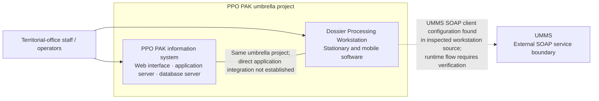

# ППО ПАК / PPO PAK — Technical Documentation

---

## Overview

Evidence-based documentation for the PPO PAK project and its related system boundaries. The project includes the PPO PAK information system and the Dossier Processing Workstation as distinct applications with separate runtime boundaries; UMMS is documented as a related system boundary. This repository is a documentation hub, not a single executable product.

## Solved Problems

- Documenting system boundaries between the PPO PAK information system and the Dossier Processing Workstation (historical project label: ARM «Дешифратор»)
- Documenting the UMMS SOAP client/service boundary without merging UMMS into PPO PAK
- Maintaining evidence-based architectural reconstruction
- Separating historical notation from current functional distinctions

## System Boundaries & Module Composition

| Module | Description | Boundary Status |
|---|---|---|
| ППО «Территория» | PPO PAK information system — modular web application with client web interface, application server, and database server | Separate application boundary |
| АРМ «Дешифратор» | Specialized document-processing workstation application with stationary and mobile software stations | Separate application and runtime boundary within the umbrella project |
| UMMS / SOAP | Related SOAP client/service boundary; a client component is present in the inspected workstation source materials | Separate system/service boundary; exact deployment and end-to-end flow require verification |

## C1 System Context Diagram

The diagram is a logical context view. It distinguishes the two applications within the PPO PAK umbrella project and keeps UMMS as a separate system boundary. The dotted relationship to UMMS records the inspected SOAP-client evidence; it does not claim a verified production endpoint or deployment topology.

## Documentation Technology Stack

| Area | Technology | Verified role |
|---|---|---|
| Documentation framework | Docsify 4.13.1 | Renders the documentation hub from Markdown; configured in `index.html` |
| Diagram notation | Mermaid | Source notation for architecture diagrams in Markdown and HTML documentation |
| Validation runtime | Python 3.11 | Runs custom validation scripts in GitHub Actions |
| Validation checks | Python standard library (`re`, `pathlib`, `sys`) | Checks Markdown code-fence balance, disallowed local paths, legacy Mermaid syntax, and selected PII patterns |
| CI | GitHub Actions | Runs repository validation on pushes and pull requests to `main` |
| Static-site staging | `rsync` | Copies publishable repository content into the `_site` staging directory; excludes source archives and workflow files |
| Hosting and deployment | GitHub Pages Actions | Uploads the `_site` artifact and deploys it to GitHub Pages |

**Deployment clarification:** `rsync` is a staging/copy step inside the GitHub Actions Pages workflow. It is not the hosting platform or a direct deployment target. GitHub Pages deployment is performed by `actions/upload-pages-artifact` and `actions/deploy-pages`.

## Documentation Navigation

- [Architecture catalogue](materials/architecture/README.md)
- [System context and scope — RU](materials/architecture/system-context-and-scope.ru.md) · [EN](materials/architecture/system-context-and-scope.en.md)
- [Data exchange and administration — RU](materials/architecture/data-exchange-and-administration.ru.md) · [EN](materials/architecture/data-exchange-and-administration.en.md)
- [Access control — RU](materials/architecture/access-control.ru.md) · [EN](materials/architecture/access-control.en.md)
- [PPO PAK](materials/territory/README.md)
- [Database and API](materials/territory-database/README.md)
- [Dossier Processing Workstation](materials/descriptor/README.md)
- [UMMS / SOAP](materials/umms/README.md)
- [Supplementary source systems](materials/reference-systems/README.md)

## Evidence & Sanitization Notice

- **Evidence status**: Source-based / Anonymized
- **CI**: GitHub Actions validation workflow
- **PII Review**: Binary source files (.pdf, .odg, .wmf) excluded from public build
- **Evidence policy**: Preserve original source archive and canonical evidence records
- **Sanitization**: CI checks selected local-path and PII patterns; these checks do not certify all published content as PII-free

---

## Evidence and publication policy

- Distinguish documented requirements, inspected source-code findings, logical reconstruction and unverified hypotheses
- Do not invent modules, interfaces, database relations, protocols or deployment topology
- Do not publish production credentials, personal data, private keys, protected network details or live exchange files
- Historical product addresses and support contacts are source references, not verified current services
- Preserve the original source archive and the canonical evidence records; duplicate documentation repositories are reduced to redirect pointers after their unique content is merged

## Evidence & Quality Governance

- **Evidence status**: Source-based / Anonymized
- **CI**: GitHub Actions validation and GitHub Pages deployment
- **PII Review**: Pending — binary source files (.pdf, .odg, .wmf, including uppercase extensions) are excluded from the public build; this does not certify the remaining content as PII-free
- **Evidence policy**: [Evidence & documentation quality policy](https://ekatmoz88-alt.github.io/github-profile-dashboard-vite/#evidence-policy)

## Structure

- `materials/territory/` — PPO PAK.
- `materials/territory-database/` — PPO PAK database, API and models; Oracle here refers to the DBMS identified in the PPO PAK source materials, not the independent Oracle DMRS / GLOBAL11 project.
- `materials/descriptor/` — Dossier Processing Workstation specification (historical source notation: «ППО ПАК»).
- `materials/deshifrator/` — software-component documentation and available source excerpts for the Dossier Processing Workstation.
- `materials/umms/` — UMMS SOAP and client documentation.
- `materials/reference-systems/` — other separately classified source materials.

## Publication

Project site: https://ekatmoz88-alt.github.io/territory-descriptor-unified/

## Tags

`architecture-catalogue` · `mermaid` · `enterprise-systems` · `ppo-pak` · `umms` · `en-ru`
