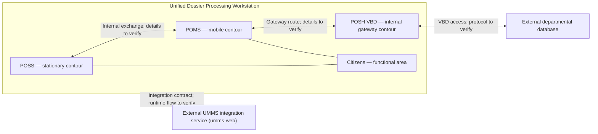

# System Context and Architecture Boundaries of the Unified Workstation

> **Governance:** ARM PPO “Territory”, ARM “Deshifrator”, R&D project “Diskriptor-14”, and Dossier Processing Workstation are names for one software workstation. POSS, POMS, and POSH VBD are internal contours of that workstation. “Citizens” is an internal functional area for individual dossiers. UMMS (`umms-web`) is an external integration system/service.

> **Evidence status:** this document presents a logical model and historical architecture evidence. It is not a reconstruction of a specific installation's physical topology.

## 1. Identity and boundaries

| Term | Meaning |
|---|---|
| ARM PPO “Territory” | Name of the software workstation / complex |
| ARM “Deshifrator” | Alternative name for the same workstation |
| R&D “Diskriptor-14” | R&D project name for the same workstation |
| Dossier Processing Workstation | English designation for the same workstation |
| POSS | Internal stationary contour |
| POMS | Internal mobile contour |
| POSH VBD | Internal gateway contour for access to VBD |
| “Citizens” | Internal functional area for individual dossiers |
| UMMS / `umms-web` | External integration system/service |

Do not automatically equate POSS, POMS, or POSH VBD with `ModuleStationary`, `ModuleMobile`, or specific assemblies. These are different classification levels; mappings require traceability to specifications and source code.

## 2. Logical context diagram

This is a boundary view, not a claim about a specific protocol or physical network topology. Internal routes must be checked against the original specification and source code.

## 3. Historical architecture evidence

Historical documentation includes a three-tier web architecture: client interface, application server, and database server. This is retained as source evidence, but it does not prove that POSS, POMS, or POSH VBD are implemented as web clients/servers or belong to a second application boundary. That wording must not override the canonical identity of the single workstation.

Historical sources also describe centralized and distributed deployment modes. Their applicability to specific workstation contours requires verification against the primary document and the configuration of an actual installation.

## 4. Integrations

- UMMS (`umms-web`) is an external system/service; SOAP contract details and runtime routing are documented separately.
- VBD is an external departmental database accessed through the workstation's internal POSH VBD contour.
- File exchange between internal contours and MRZ are documented in [integration architecture](./integration-and-file-exchange.md) and [format specifications](./data-exchange-and-mrz.md).

## 5. Evidence limitations

- The identity of the four workstation names is the canonical documentation rule.
- `ConnectionFactory.cs` alone does not prove POSH VBD implementation; it belongs only to the SQLite DAL.
- POSS/`ModuleStationary` and POMS/`ModuleMobile` mappings are not considered established without explicit traceability.
- A SOAP ViewModel or a reference to `UmmsNp.cs` does not prove the endpoint, authorization, or complete network flow.
