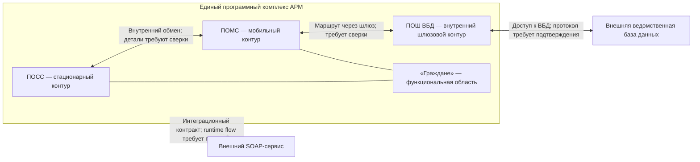

# Контекст и архитектурные границы единого АРМ

> **Границы системы:** АРМ обработки досье — единое программное рабочее место. ПОСС, ПОМС и ПОШ ВБД — его внутренние контуры. «Граждане» — функциональная область обработки досье физических лиц. Внешний SOAP-сервис является отдельной интеграционной границей.

> **Статус источника:** документ отражает логическую модель и исторические архитектурные материалы. Он не является реконструкцией физической топологии конкретной инсталляции.

## 1. Идентификация и границы

| Термин | Значение |
|---|---|
| АРМ обработки досье | Наименование программного комплекса / рабочего места |
| АРМ обработки досье | Альтернативное наименование того же АРМ |
| Проектное обозначение | Не публикуется |
| Case Processing Workstation | Англоязычное обозначение того же АРМ |
| ПОСС | Внутренний стационарный контур |
| ПОМС | Внутренний мобильный контур |
| ПОШ ВБД | Внутренний шлюзовой контур доступа к ВБД |
| «Граждане» | Функциональная область АРМ для работы с досье физических лиц |
| Внешний SOAP-сервис | Внешняя интеграционная граница |

ПОСС, ПОМС и ПОШ ВБД нельзя автоматически приравнивать к `ModuleStationary`, `ModuleMobile` или конкретным assemblies. Это разные уровни классификации; соответствие требует трассировки по спецификациям и исходному коду.

## 2. Логическая контекстная схема

Диаграмма показывает архитектурные границы, а не утверждает конкретный протокол или физическую схему соединений. Внутренние маршруты должны проверяться по оригинальной спецификации и исходникам.

## 3. Исторические архитектурные сведения

В исторической документации встречается описание трёхуровневой веб-архитектуры: клиентский интерфейс, сервер приложений и сервер базы данных. Это описание сохраняется как источник архитектурных сведений, но само по себе не доказывает, что ПОСС, ПОМС или ПОШ ВБД реализованы как веб-клиенты/серверы либо входят в отдельное приложение. Нельзя на основании этой формулировки вводить вторую границу приложения или менять единую идентификацию АРМ.

Также встречаются описания централизованного и распределённого режимов размещения. Их точная применимость к конкретным контурам АРМ требует проверки первичного документа и конфигурации конкретной инсталляции.

## 4. Интеграции

- Внешний SOAP-сервис — отдельная интеграционная граница; детали контракта и маршрута обмена описываются отдельно.
- ВБД — внешняя ведомственная база данных, к которой обращается внутренний контур ПОШ ВБД.
- Файловый обмен между внутренними контурами и MRZ описаны в [архитектуре обмена](./integration-and-file-exchange.md) и [спецификации форматов](./data-exchange-and-mrz.md).

## 5. Ограничения доказательности

- Идентичность четырёх наименований АРМ — каноническое правило этой документации.
- Реализация ПОШ ВБД не подтверждается одним лишь наличием `ConnectionFactory.cs`; этот класс относится только к SQLite DAL.
- Соответствие ПОСС/`ModuleStationary` и ПОМС/`ModuleMobile` не считается установленным без явной трассировки.
- Наличие SOAP ViewModel или упоминания `UmmsNp.cs` не подтверждает endpoint, авторизацию или полный сетевой поток.
