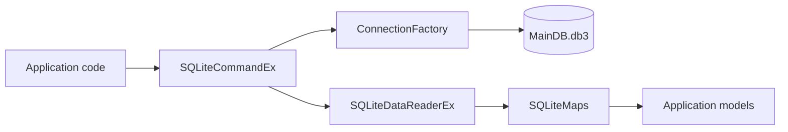

# C# / SQLite Data Access Layer Review

## Scope and method

This document records a source-based review of the `DbStationary` C# data access layer. The review covers the supplied implementation excerpts from the connection factory, command wrapper, parameter helpers, data reader extensions, mapping layer and provider classes.

The original application source is not published in this portfolio repository. The findings below are documented evidence from the inspected source excerpts; this page is a review artifact, not a mirror of the application source code.

The review is static. It does not claim that the application was built, executed, load-tested or covered by a complete automated test suite.

## Component responsibilities

| Component | Observed responsibility |
| --- | --- |
| `ConnectionFactory` | Creates, opens and returns the SQLite connection. |
| `SQLiteCommandEx<T>` | Wraps command execution and result handling. |
| `SQLiteCommandEx_Params` | Creates and binds SQLite parameters, including GUID helpers. |
| `SQLiteDataReaderEx` | Provides typed access to values returned by a reader. |
| `SQLiteMaps` | Maps database values to application models. |
| Providers | Execute application-level data operations. |

> **Model boundary:** Application Models are shown as consumers of mapped data in the diagrams. They are not listed as data-access-layer components.

## Findings

| Area | Source evidence | Review status |
| --- | --- | --- |
| Thread safety | `ConnectionFactory.cs:11, 27–33` uses a static singleton and returns the same connection without visible locking. `CaseProvider.cs:43–45` begins transactions on that shared connection. | Risk identified |
| Connection lifecycle | `ConnectionFactory.cs:18–24` creates and opens the connection in the factory constructor. `GetConnection()` reuses it; no close/dispose path is implemented in this class. | Partially verified |
| Resource disposal | `SQLiteCommandEx.cs:99–110, 130–141, 162–173, 235–239, 261–265` contains execution paths using `using`. Parameter-array overloads at `197–215, 248–252, 275–279` do not dispose the command. The factory retains its connection. | Inconsistent disposal |
| DataReader lifecycle | `SQLiteCommandEx.cs:220–227`: `AsDataReader()` returns a reader from inside a `using` scope, so it is disposed before the caller can consume it. | Defect confirmed |
| Parameter handling | `SQLiteCommandEx_Params.cs:10–22, 25–36` creates and adds named parameters. `SQLiteCommandEx.cs:299–302` maps null to `DBNull.Value`. `ResetParams` relies on `Debug.Assert` for count matching (`286–293`). Provider call sites use parameterized commands. | Partially verified |
| Type conversion | `SQLiteDataReaderEx.cs:28–30, 33–102, 104–121` contains a direct generic cast, typed getters and DBNull checks. `SQLiteMaps.cs:24–91` uses these methods in model mapping. Conversion behavior was not comprehensively tested. | Partially verified |
| GUID processing | `CaseProvider.cs:54` stores `CaseGUID` as a string; `SQLiteMaps.cs:36–38` reads it using `Guid.Parse`. `SQLiteCommandEx_Params.cs:140–155` defines GUID parameter helpers. No round-trip test evidence was supplied. | Partially verified |
| Error handling | `CaseProvider.cs:308–312` catches, logs and rethrows exceptions in `LoadCases()`. The inspected command execution methods generally propagate exceptions; a consistent logging policy is not visible across providers. | Partially verified |

## Recommended follow-up verification

1. Trace connection ownership from creation through disposal.
2. Inspect concurrent execution paths and define thread-safety guarantees.
3. Verify reader, command and connection disposal on success and failure paths.
4. Test parameter binding, argument-count mismatches, nulls and unexpected values.
5. Add type-conversion and GUID round-trip tests.
6. Review exception handling and ensure diagnostic logs do not expose sensitive data.

## Limitations

The statuses describe only the supplied source excerpts. In particular, the concurrency risk is not a demonstrated runtime failure, and the disposal and conversion findings should be validated with focused tests. The confirmed reader defect follows directly from the `using` scope in the inspected `AsDataReader()` implementation.

This is an independent C# / SQLite review case. It is not part of the Oracle Global11 project.

## Additional architecture reconstruction and verification inputs

- `ConnectionFactory` — singleton-подобная фабрика, создающая один `SQLiteConnection`, открывающая его в конструкторе и возвращающая через `GetConnection()`.
- `SQLiteCommandEx<T>` — fluent-обёртка над `DbCommand`; поддерживает маппинг результатов, scalar/non-query/list/enumerable.
- `SQLiteCommandEx_Params` — расширение для создания типизированных параметров.
- `SQLiteDataReaderEx` — вспомогательное чтение столбцов по имени с кешированием ordinal.
- `SQLiteMaps` — mapping-функции из строк результата SQL в модели приложения.

## Поток данных (наблюдаемый по предоставленным файлам)

## Риски и вопросы для проверки

1. **Singleton и потокобезопасность.** `_instance` и общее `_connection` не синхронизированы. Один открытый connection может использоваться конкурентно из разных потоков.
2. **Время жизни соединения.** `ConnectionFactory` открывает соединение один раз и не предоставляет явного механизма закрытия/освобождения.
3. **Освобождение команды.** `AsList`, `AsEnumerable`, `AsSingle`, `AsScalar` и `AsNonQuery` в отдельных перегрузках используют `using (_command)`, то есть уничтожают команду. Другие перегрузки повторно используют команду. Это поведение легко перепутать.
4. **`AsDataReader`.** Метод возвращает reader из блока `using`; при выходе из блока reader уже будет закрыт/освобождён. Это функциональный дефект.
5. **Параметры.** `ResetParams` проверяет число параметров только через `Debug.Assert`; в Release эта проверка может отсутствовать. Параметры задаются позиционно, что хрупко.
6. **Преобразование типов.** `GetValue<T>` делает прямое приведение; `GetStringNullable` возвращает пустую строку вместо `null`. Это может скрывать разницу между NULL и пустым значением.
7. **GUID.** `SQLiteMaps.CaseModelMap` читает `CaseGUID` как строку и вызывает `Guid.Parse`; неверный/пустой формат приведёт к исключению.
8. **Имена и типы.** В `SQLiteMaps` часть дат читается как `DateTime`, а часть как `string`. Реальный формат SQLite и SQL-запросы не приложены — проверить корректность нельзя.

## Что нужно для верификации

- файл `MainDB.db3` или `sqlite_schema`;
- SQL-запросы, передаваемые в `SQLiteCommandEx`;
- определения моделей из `Common.Data.Models`, `Common.Data.Models.Umms`, `DbStationary.Models`;
- целевая версия .NET и NuGet-зависимости.
