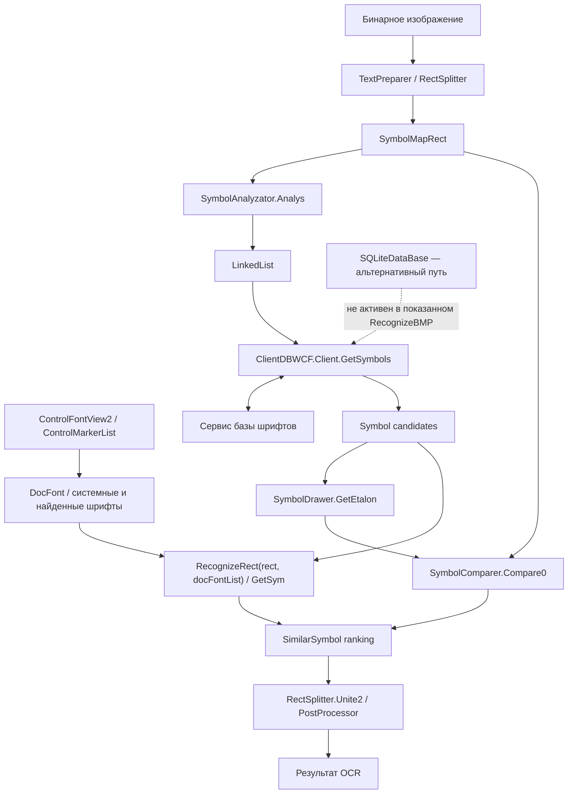

# OCR и распознавание шрифтов — реконструкция по исходным листингам

> **Статус:** source-based analysis / реконструкция по предоставленным фрагментам C# (в том числе листинги стр. 1145–1276). Документ фиксирует подтверждённые конструкции исходного кода и отдельно отмечает вопросы для проверки. Это не результат запуска OCR и не подтверждение качества распознавания на реальных изображениях.

## 1. Границы и место компонента

В листингах присутствует пространство имён `DeclarationCommon.Controls.AltOCR`, класс `AltOCR`, а также UI-компоненты выбора шрифтов. Ранее рассмотренные фрагменты `PassportPaint` подтверждают отдельный контур макетирования и печати. По представленным материалам OCR-функциональность относится к тому же программному комплексу АРМ обработки досье, однако конкретная runtime-связь `AltOCR` с `PassportPaint.MainPaintControl` пока не подтверждена полным графом вызовов.

Не следует отождествлять OCR-подсистему с генерацией МЧЗ: это разные функции, хотя обе могут участвовать в обработке/оформлении документа.

## 2. Компоненты пользовательского интерфейса

### 2.1. `ControlFontView2`

Компонент предоставляет интерфейс работы с тремя наборами шрифтов:

- системные шрифты;
- выбранные шрифты;
- найденные (распознанные) шрифты.

По листингу подтверждены:

- загрузка исходного списка `DocFont`;
- построение списка уникальных имён шрифтов;
- удаление дубликатов найденных шрифтов по сочетанию `FontName`, `FontSize`, `FontType`;
- добавление выбранного шрифта с параметрами размера, Bold/Italic и `Tension`;
- удаление одного или всех выбранных шрифтов;
- обновление предпросмотра при изменении текста или выбранного шрифта;
- подписка и отписка от событий дочернего элемента при загрузке/выгрузке контрола.

Метод `AddFontToTable` проверяет дубликаты по `FontName`, `FontSize`, `FontType` и `Tension`.

### 2.2. `ControlMarkerList`

Компонент отображает системные шрифты, получаемые через `FontSI.GetListSystemFont()`. Предусмотрены фильтры по русскому, английскому и всем языкам, поиск по началу строки и расширенный поиск по вхождению подстроки. Может поднимать отмеченные элементы в начало списка.

Двойной щелчок вызывает событие `ListDoubleClick`. Фильтрация реализована на коллекции `ObservableCollection`.

## 3. Конвейер OCR

### 3.1. Входные данные и предварительная обработка

Основной метод `RecognizeBMP` принимает бинаризованное изображение `Bitmap` (в комментарии указано: чёрно-белое, один байт на пиксель), перечень имён шрифтов, типы шрифтов, каталог данных, DPI, порог и необязательные параметры фильтрации/обработки.

Последовательность по коду:

1. Создаётся список областей `rects`.
2. `TextPreparer.Prepare` выделяет прямоугольные области символов с учётом порога, DPI, `AreaFilter` и исключённых областей.
3. При `oneSymbol == true` несколько найденных областей объединяются через `RectSplitter.Combine`.
4. В зависимости от `Config.Settings.FindFontDefragmentation` вызываются `RectSplitter.Split3`, `Split2` и/или `Defragment2`.
5. Для обычного режима выполняется `FilterRects`.
6. Типы `FontType` преобразуются в `System.Drawing.FontStyle`.
7. Загружаются шрифты через `ClientDBWCF.Client.LoadFonts`.
8. Каждый прямоугольник обрабатывается в `Parallel.For`.
9. Для кандидатов выполняется сравнение с эталонами через `SymbolDrawer.GetEtalon` и `SymbolComparer.Compare0`.
10. Выполняется объединение результатов split/defragmentation через `RectSplitter.Unite2` и постобработка `PostProcessor.PostProcess`.

### 3.2. Поиск кандидатов

`RecognizeRect(SymbolMapRect rect)` выполняет несколько попыток анализа:

- вызывает `SymbolAnalyzator.Analys` для текущего прямоугольника;
- передаёт полученный список `Codes` в `ClientDBWCF.Client.GetSymbols`;
- сортирует найденные объекты `Symbol`;
- проверяет отношение ширины к высоте;
- оценивает масштаб по отношению площадей прямоугольника и эталонного символа;
- отбрасывает кандидатов за пределами `Global.MinFontSize` и `Global.MaxFontSize`;
- формирует `SimilarSymbol` с размером, предварительной оценкой и ссылкой на исходный прямоугольник;
- сравнивает кандидатов с эталонными изображениями;
- сортирует результаты по `SimilarSymbol.CompareSimilarity` и ограничивает их числом `Global.MaxSimSymbolsRec`.

Таким образом, поиск состоит из двух стадий: кодовый поиск по базе символов, затем геометрическая фильтрация и сравнение с эталонным изображением.

### 3.3. Режим с ограничением по шрифтам документа

Перегрузка `RecognizeRect(rect, docFontList)` дополнительно учитывает список `DocFont`.

Метод `GetSym` выбирает записи с совпадающими именем и стилем шрифта, определяет ближайший размер и корректирует оценку:

`Similarity_new = (mult² × Similarity_old)^(1/3)`

где `mult` — отношение меньшего размера шрифта к большему. Если подходящий шрифт не найден, оценка кандидата устанавливается в ноль.

Это отдельный режим ранжирования: набор символов ищется тем же WCF-клиентом, но итоговый кандидат дополнительно ограничивается заданными шрифтами и размерами документа.

## 4. `SymbolAnalyzator`: извлечение структурных признаков

### 4.1. Многократный анализ

`AnalysForDataBaseGenerator` запускает `Analys` для всех значений `attempt` от нуля до `Global.SumAttemptCount - 1`. Непустые последовательности сохраняются в результирующий список. Если все попытки пусты, метод возвращает последовательность, содержащую только `Codes.Slash`.

Название и XML-комментарий метода указывают на использование для генерации базы данных. Сам вызов этого метода в предоставленных фрагментах генератора пока не показан.

### 4.2. Настройка чувствительности

Для каждой попытки рассчитываются `visibleSize0X` и `visibleSize0Y` на основе относительных значений `Global.VisibleSize` и размеров изображения. Затем добавляются поправки `Global.OrderX` и `Global.OrderY`.

При соотношении сторон, превышающем 2.2, алгоритм корректирует чувствительность по соответствующей оси. Если итоговый порог по одной из осей меньше 2, попытка возвращает пустой список.

### 4.3. Вычисляемые признаки

| Массив | Содержание |
|---|---|
| `columnSums` | Число закрашенных пикселей в каждом столбце |
| `rawSums` | Число закрашенных пикселей в каждой строке |
| `columnLines` | Число обнаруженных переходов между состояниями цвета по столбцам |
| `rawLines` | Число переходов по строкам |
| `Heights` | Оценка высоты заполненной части каждого столбца |
| `Widths` | Оценка ширины заполненной части каждой строки |

По этим массивам формируются признаки:

- количество смен цвета и их распределение;
- увеличение/уменьшение заполненности;
- изменение высоты заполненных областей;
- изменение ширины заполненных областей.

Результат записывается в `LinkedList<Codes>`. Значения для счётчиков переходов формируются выражением `(Codes)(j + 5)`; точная семантика каждого числового значения требует сверки с определением enum `Codes`.

Маркер `Codes.Slash` разделяет признаки, вычисленные по столбцам, и признаки, вычисленные по строкам.

### 4.4. Вспомогательные группы связности

В классе присутствуют `Group`, `AddGroup` и `MergeGroups`. Модель хранит компоненту связности и координаты границ. `MergeGroups` объединяет идентификаторы компонент и исправляет ссылки в `column2`.

В предоставленном фрагменте вызовы этих методов отсутствуют. Поэтому наличие вспомогательной модели подтверждено, но её фактическое участие в активном алгоритме сегментации — нет.

## 5. Хранилище базы шрифтов

### 5.1. Активный путь и альтернативная реализация

В показанном `RecognizeBMP` активные вызовы выполняются через:

- `ClientDBWCF.Client.Connect()`;
- `ClientDBWCF.Client.LoadFonts(fontNames, fontStyles, Config.Settings.DBPath)`;
- `ClientDBWCF.Client.GetSymbols(code)`.

В том же фрагменте локальная SQLite-реализация и генерация локальной базы закомментированы. Класс `SQLiteDataBase` присутствует в исходниках как альтернативный механизм хранения/поиска, но его использование в показанном рабочем конвейере не подтверждено.

### 5.2. Структура SQLite

Класс создаёт реестр шрифтов `fonts` и отдельные таблицы для каждого нормализованного названия шрифта:

| Таблица | Назначение |
|---|---|
| `fonts` | `fontTitle`, `fontName`, `fontType` |
| `{fontTitle}` | Код признаков, индекс символа и номер части символа |
| `{fontTitle}_s` | Номер символа, знак, число частей, индекс сортировки, ширина и высота |

`GetHash(LinkedList<Codes>)` упаковывает пары кодов в символьную строку для индексного поиска. `GetHash(List<Symbol>)` формирует строковое представление списка символов. `normalizeFontTitle` заменяет пробелы на подчёркивания.

### 5.3. Ограничения SQLite-варианта

- В запросах значения и имена таблиц формируются конкатенацией строк; параметризация SQL не показана.
- `GetSymbols` вызывает `reader.Read()` только один раз и добавляет не более одной строки на таблицу шрифта, даже если запрос вернул несколько совпадений.
- В конструкторе чтения при отсутствии записи в `fonts` выполняется `continue`, но последующее обращение к `_fonts[i]` и `_symbols[i]` использует индекс исходного списка `_fontTitles`. При пропуске записи возможна рассинхронизация индексов.
- Соединение закрывается в финализаторе; явный `Dispose` для `SQLiteDataBase` в представленном фрагменте отсутствует.
- Путь к файлу БД задан в коде, а не передаётся через параметр конфигурации данного класса.
- В таблицах символов не видно первичного ключа или уникального ограничения на `code`; фактическая кратность совпадений зависит от способа заполнения.

Эти замечания относятся к показанному SQLite-коду и не доказывают, что он использовался в рабочей конфигурации.

## 6. Логическая схема компонентов

Схема логическая: она не описывает deployment topology, сетевые адреса, реализацию WCF-сервиса или физическую структуру серверной базы.

## 7. Реестр замечаний по OCR

Ниже объединены замечания по ранее присланным фрагментам `ControlFontView2`, `AltOCR`, `SymbolAnalyzator` и `SQLiteDataBase`.

| ID | Наблюдение | Статус / что проверить |
|---|---|---|
| OCR-01 | `GetSelectedFoundFont()` обращается к `_selectedFont` без видимой проверки на `null` | Потенциальный `NullReferenceException`; проверить вызовы до выбора шрифта |
| OCR-02 | `ScaleChanged` объявлено, но вызов события в обработчике изменения масштаба в показанном фрагменте отсутствует | Проверить XAML и подписчиков |
| OCR-03 | Порог приводится к `byte` при присваивании `Global.Treshold` | Проверить диапазон входного `treshold`; значения вне 0–255 могут преобразовываться некорректно |
| OCR-04 | Для `Area` в `AltOCR` показано двойное преобразование через `PixTomm` | Проверить единицы измерения `BlackSum` и ожидаемый тип `Area` |
| OCR-05 | В ветке `oneSymbol` преобразования ширины/высоты требуют проверки на согласованность единиц | Сверить формулы и контракт `DocRectangle` |
| OCR-06 | В `RecognizeSymbols1` исходная ссылка на bitmap заменяется ссылкой на обработанный crop, после чего при определённом условии вызывается `Dispose` | Проверить владение изображением и возможность освобождения объекта, принадлежащего вызывающему коду |
| OCR-07 | `Global.Init(fontNames.Count * fontTypes.Count)` вызывается без видимой проверки пустых наборов | Проверить предусловия и поведение при пустых списках |
| OCR-08 | `counter` изменяется из нескольких потоков внутри `Parallel.For` без синхронизации | Значения прогресса и диагностические отметки могут быть неточными; проверить потокобезопасность `ProgressDialog.Current.Report` |
| OCR-09 | В расчёте `Heights` переменная `sum` не сбрасывается перед обратным проходом по строкам | По видимому коду второй проход продолжает счёт первого; проверить ожидаемую формулу нижней границы |
| OCR-10 | SQLite-конструктор пропускает отсутствующий `fontTitle`, но индексирует `_fonts` и `_symbols` исходным индексом `i` | При пропуске записи возможен выход за границы коллекции или неверное соответствие индексов |
| OCR-11 | SQLite `GetSymbols` читает только первую строку результата | Остальные совпадения запроса теряются |
| OCR-12 | SQLite SQL строится конкатенацией значений и динамических имён таблиц | Проверить экранирование, параметризацию значений и безопасное формирование идентификаторов |
| OCR-13 | Путь к SQLite-файлу задан константой в классе | Проверить переносимость и конфигурирование; буквальный путь в публичной документации не приводится |
| OCR-14 | `AddGroup` использует индексацию с нуля/единицы, но инициализация `groups` в листинге не показана | Проверить наличие sentinel-элемента с индексом 0 до первого вызова |
| OCR-15 | При отмене или ошибке `RecognizeBMP` возвращает текущий список `rects` | Вызывающий код должен отличать частичный результат от полного |

### Дополнительные ограничения алгоритма

- `Analys` не проверяет в начале соответствие размеров `map`, `width` и `height`; корректность входного массива является предусловием.
- Деление на `Global.AttemptCount` и индексация `Global.VisibleSize` предполагают согласованные настройки. Их диапазоны в предоставленном фрагменте не проверяются.
- Если `AnalysForDataBaseGenerator` возвращает fallback `Codes.Slash`, этот маркер совпадает с разделителем направлений в обычной последовательности. Нужно проверить, как генератор базы различает пустой результат и разделитель.
- Точная семантика кодов `(Codes)(j + 5)` требует определения enum `Codes`.
- Ошибки отдельного символа в `RecognizeBMP` логируются, но не прерывают весь параллельный проход; итоговый список может содержать частично обработанные области.

## 8. Что остаётся проверить

1. Определение enum `Codes`, а также значения `Global.VisibleSize`, `AttemptCount`, `OrderX`, `OrderY` и `SumAttemptCount`.
2. Реализацию `ClientDBWCF.Client` и серверную сторону сервиса базы шрифтов.
3. Код генератора базы, который вызывает `AnalysForDataBaseGenerator`.
4. Реализации `SymbolDrawer.GetEtalon`, `SymbolComparer.Compare0`, `SimilarSymbol.CompareSimilarity` и `PostProcessor.PostProcess`.
5. Вызовы `RecognizeBMP` и `RecognizeRect` из UI, включая связь с `PassportPaint`.
6. XAML и подписчиков `ControlFontView2` / `ControlMarkerList`.
7. Фактическое использование SQLite-варианта: создание, заполнение и чтение БД.

## 9. Итог

Предоставленные листинги подтверждают OCR-конвейер с выделением областей изображения, извлечением структурных признаков, поиском кандидатов в базе шрифтов через WCF, геометрической фильтрацией, сравнением с эталонами и постобработкой. Поддерживается режим дополнительного ограничения набора кандидатов шрифтами документа.

SQLite-класс представляет альтернативный механизм локального хранения, но в показанном `RecognizeBMP` активен WCF-путь, а вызовы SQLite-загрузки/поиска закомментированы. Реализация сервиса базы шрифтов и алгоритм генерации её содержимого остаются за пределами имеющихся фрагментов.
