# Реконструированная логическая модель данных

> **Governance disclaimer:** это `Reconstructed Logical Data Model (PostgreSQL)`, а не физическая схема промышленной Oracle- или SQLite-БД. Модель предназначена для демонстрации связей и тестовых сценариев.
>
> **DDL review:** миграции от 25.11.2026 сверены построчно с исходной схемой. Не добавлялись CHECK-ограничения, отсутствующие в источнике; семантика `chk_mrz_date` сохранена. Служебная `flyway_schema_history` не входит в число 24 прикладных таблиц.
>
> **Статус тестового контура:** `Prepared / Pending CI verification`. Достоверный лог успешного запуска не приложен.

## Состав 24 таблиц по 9 группам

| Группа | Таблицы | Количество |
|---|---|---:|
| НСИ | `ref_document_type`, `ref_document_reason`, `ref_department` | 3 |
| Граждане | `person`, `person_relation` | 2 |
| Документы | `document`, `document_operation` | 2 |
| Адреса и дела | `address_registration`, `dossier_case`, `dossier_signal` | 3 |
| Паспортные штампы (стр. 5–19) | `passport_stamp_registration`, `passport_stamp_military`, `passport_stamp_marriage`, `passport_stamp_children`, `passport_stamp_prev_docs` | 5 |
| Печать | `print_page_state`, `used_blank_journal` | 2 |
| Обмен | `export_batch`, `export_batch_person`, `edit_scenario_log` | 3 |
| Аудит | `audit_log` | 1 |
| Шлюз ВБД | `vbd_dossier_snapshot`, `gateway_connection_log`, `gateway_dictionary_version` | 3 |
| **Итого** | **Прикладные таблицы; без `flyway_schema_history`** | **24** |

## ER-диаграмма

Связи на диаграмме построены по явно заданным внешним ключам в `V002__constraints_and_fk.sql`. Названия связей — ASCII-идентификаторы для совместимости Mermaid.

```mermaid
erDiagram
    %% НСИ
    ref_document_type {
        serial id PK
        varchar name
    }
    ref_document_reason {
        serial id PK
        varchar name
    }
    ref_department {
        serial id PK
        varchar code
        varchar name
        varchar region_code
        varchar region_name
    }
    %% Граждане
    person {
        bigserial id PK
        bigint external_ir_id
        varchar last_name
        varchar first_name
        varchar middle_name
        char gender
        date birth_date
        date death_date
        varchar birth_country
        varchar birth_place
        varchar citizenship
        varchar inn
        varchar military_duty_info
        boolean is_hidden
        timestamp vbd_export_date
        boolean need_external_sync
    }
    person_relation {
        bigserial id PK
        bigint person_id FK
        varchar relation_type
        varchar related_fio
        char related_gender
        date related_birth_date
        varchar act_number
        varchar issued_by
        date date_from
        date date_to
    }
    %% Документы
    document {
        bigserial id PK
        bigint person_id FK
        int doc_type_id FK
        varchar series
        varchar number
        date issue_date
        date actual_issue_date
        date valid_from
        date valid_to
        int department_id FK
        varchar dept_code
        varchar issued_by_full
        varchar application_place
        int reason_id FK
        varchar status
        boolean is_first_doc
        boolean has_mrz
        varchar mrz_line_1
        varchar mrz_line_2
        varchar executor_name
        jsonb extra_attributes
    }
    document_operation {
        bigserial id PK
        bigint document_id FK
        date operation_date
        varchar operation_name
    }
    %% Адреса и дела
    address_registration {
        bigserial id PK
        bigint person_id FK
        varchar reg_type
        date date_from
        date date_to
        varchar country
        varchar region
        varchar district
        varchar city
        varchar street
        varchar house
        varchar building
        varchar flat
        varchar full_address
        uuid fias_guid
        jsonb case_extra_attributes
    }
    dossier_case {
        bigserial id PK
        bigint person_id FK
        varchar case_number
        date open_date
        date close_date
        varchar status
        date status_date
        varchar case_type
        boolean is_applicant
        varchar applicant_fio
        varchar applicant_doc_info
        varchar person_role
    }
    dossier_signal {
        bigserial id PK
        bigint person_id FK
        varchar entity_type
        bigint entity_id
        date period_from
        date period_to
        varchar signal_type
        varchar message
        text content
    }
    %% Паспортные штампы (стр. 5–19)
    passport_stamp_registration {
        bigserial id PK
        bigint document_id FK
        int page_number
        varchar orientation
        varchar form_code
        date stamp_date
        varchar addr_country
        varchar addr_region
        varchar addr_district
        varchar addr_city
        varchar addr_street
        varchar addr_house
        varchar addr_building
        varchar addr_flat
        uuid fias_guid
        varchar department_name
        varchar dept_code
    }
    passport_stamp_military {
        bigserial id PK
        bigint document_id FK
        int page_number
        varchar form_code
        date stamp_date
        varchar dept_code
    }
    passport_stamp_marriage {
        bigserial id PK
        bigint document_id FK
        int page_number
        varchar orientation
        varchar form_code
        date event_date
        date termination_date
        varchar spouse_fio
        date spouse_birth_date
        varchar zags_name
        varchar act_number
        varchar dept_code
    }
    passport_stamp_children {
        bigserial id PK
        bigint document_id FK
        int page_number
        varchar child_fio
        char child_gender
        date child_birth_date
    }
    passport_stamp_prev_docs {
        bigserial id PK
        bigint document_id FK
        int page_number
        varchar form_code
        varchar prev_doc_series
        varchar prev_doc_number
        varchar dept_code
        date issue_date
    }
    %% Печать
    print_page_state {
        bigserial id PK
        bigint document_id FK
        int page_number
        int print_count
        boolean is_fixed
        timestamp fixed_at
        jsonb layout_snapshot
    }
    used_blank_journal {
        bigserial id PK
        bigint document_id FK
        bigint person_id FK
        varchar blank_series
        varchar blank_number
        timestamp printed_at
        varchar operator_login
        boolean is_spoiled
        text comment
    }
    %% Обмен
    export_batch {
        bigserial id PK
        varchar task_number
        timestamp approval_date
        text comment
        timestamp export_date
        timestamp import_date
        int processing_stage
    }
    export_batch_person {
        bigint batch_id PK,FK
        bigint person_id PK,FK
    }
    edit_scenario_log {
        bigserial id PK
        bigint person_id FK
        varchar scenario_code
        varchar status
        boolean is_cancelled
        boolean is_exported_to_vbd
        timestamp created_at
        varchar user_login
    }
    %% Аудит
    audit_log {
        bigserial id PK
        timestamp event_time
        varchar user_login
        varchar action_type
        jsonb details
    }
    %% Шлюз ВБД
    vbd_dossier_snapshot {
        bigserial id PK
        bigint person_id FK
        bigint external_ir_id
        varchar vbd_row_version
        jsonb snapshot_payload
        timestamp loaded_at
        timestamp expires_at
        boolean is_reverted
        timestamp reverted_at
    }
    gateway_connection_log {
        bigserial id PK
        timestamp connected_at
        inet mm_client_ip
        varchar mm_login
        boolean is_auth_success
        varchar operation_type
        int records_count
        text error_message
    }
    gateway_dictionary_version {
        varchar dict_code PK
        int version_number
        timestamp updated_at
    }
    person ||--o{ document : owns
    ref_document_type ||--o{ document : owns
    ref_department ||--o{ document : owns
    ref_document_reason ||--o{ document : owns
    document ||--o{ document_operation : operation_history
    person ||--o{ person_relation : related_to
    person ||--o{ address_registration : registered_at
    person ||--o{ dossier_case : has_case
    person ||--o{ dossier_signal : has_signal
    document ||--o{ passport_stamp_registration : registration_stamp
    document ||--o{ passport_stamp_military : military_stamp
    document ||--o{ passport_stamp_marriage : marriage_stamp
    document ||--o{ passport_stamp_children : children_stamp
    document ||--o{ passport_stamp_prev_docs : previous_document
    document ||--o{ print_page_state : print_state
    document ||--o{ used_blank_journal : blank_record
    person ||--o{ used_blank_journal : blank_record
    export_batch ||--o{ export_batch_person : batch_item
    person ||--o{ export_batch_person : batch_item
    person ||--o{ edit_scenario_log : references
    person ||--o{ vbd_dossier_snapshot : snapshot
```

## Сверка DDL

- `V001__init_tables.sql` — 24 прикладные таблицы и первичные ключи.
- `V002__constraints_and_fk.sql` — подтверждённые внешние ключи, UNIQUE и CHECK-ограничения.
- `chk_mrz_date` сохранено в исходной семантике: запрет МЧЗ при дате выдачи ранее 01.07.2011.
- `flyway_schema_history` — служебная таблица Flyway, исключена из подсчёта прикладной модели.
- Неподтверждённые CHECK-ограничения на статусы, ИНН, стадии обработки и коды сценариев не добавлялись.
