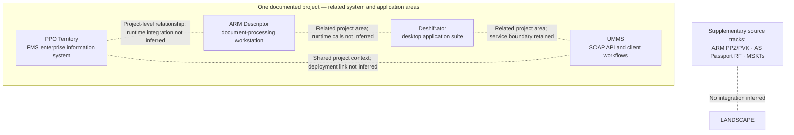
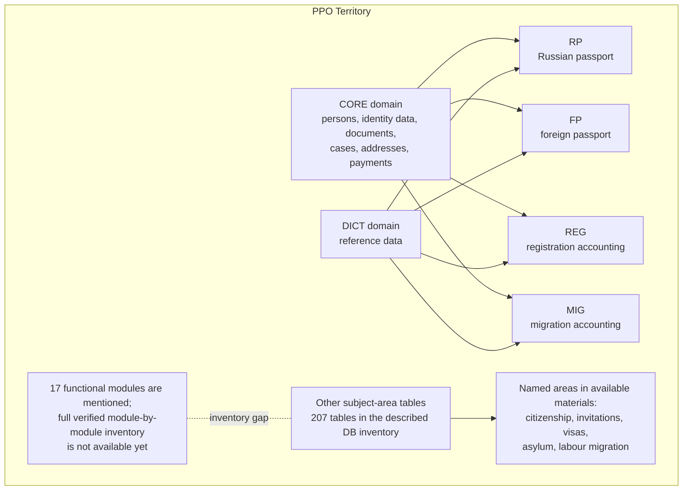
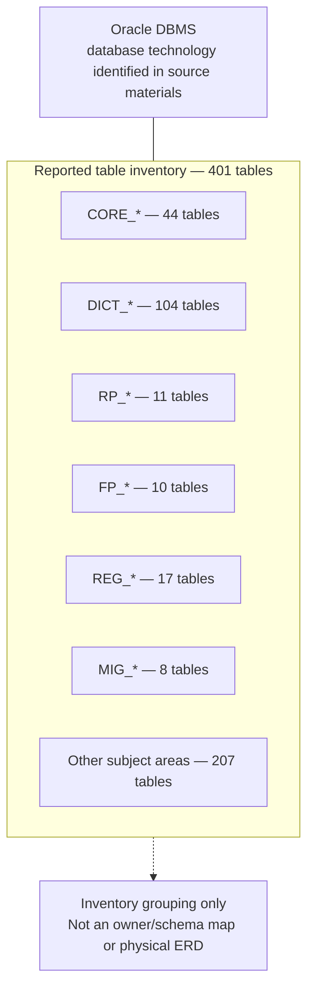
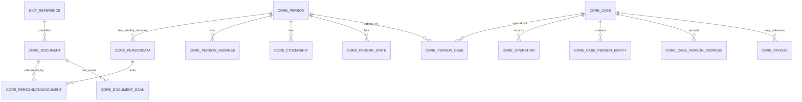
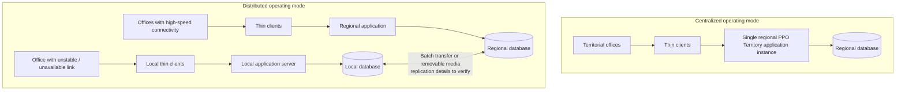
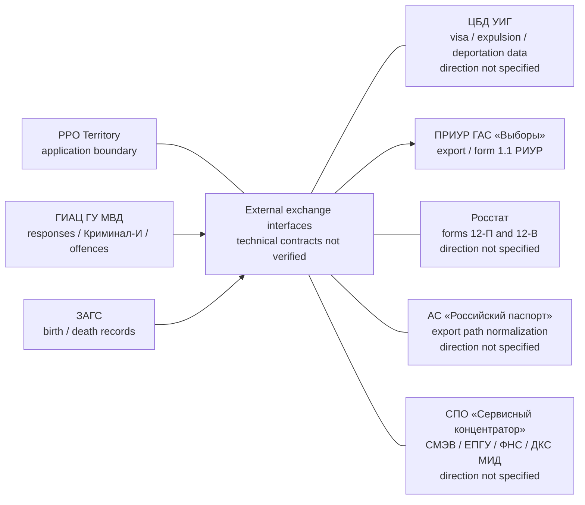
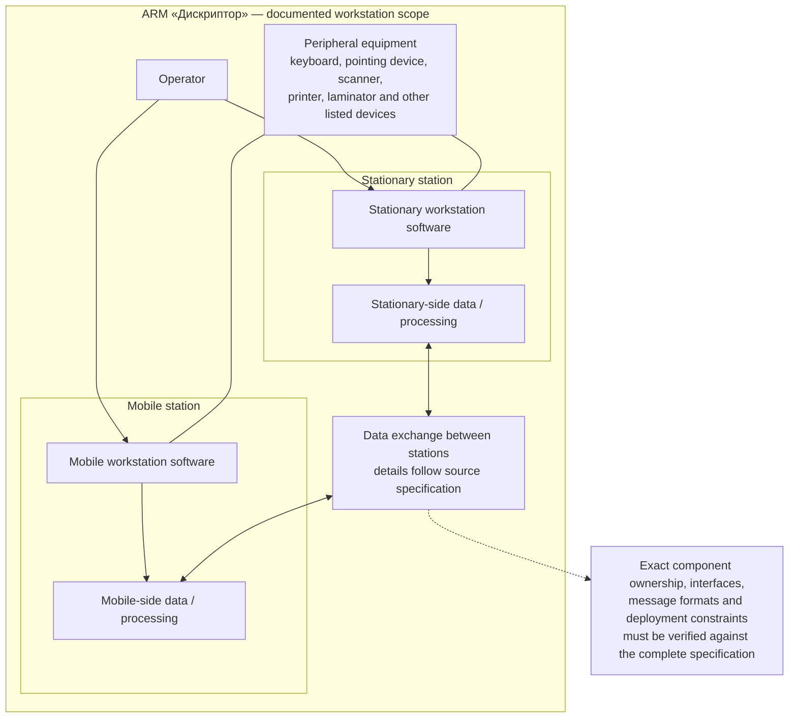
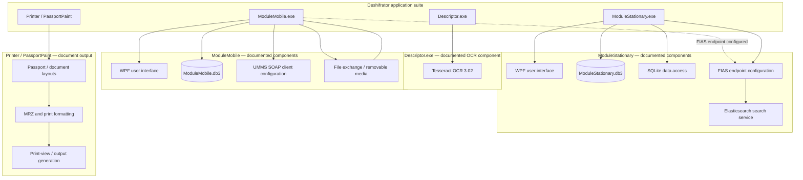
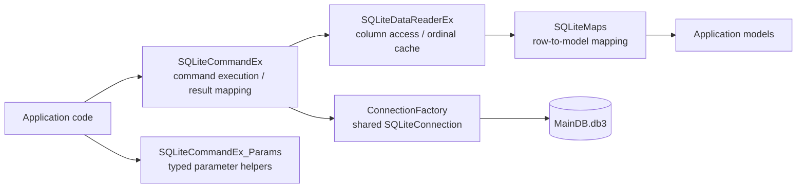
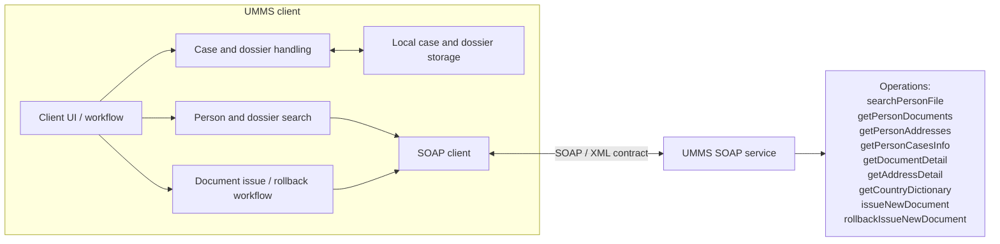

# Technical Documentation Portfolio — Architecture Catalogue

> **Interactive bilingual version:** [Open the EN/RU HTML architecture catalogue](./architecture.html). It renders the same 10 Mermaid diagrams as this Markdown source. Seven additional component-level diagrams are maintained in [component-maps.md](./component-maps.md).
>
> **Reusable Mermaid fragments:** [Open the Mermaid Patterns Library](./mermaid-patterns.md). It provides copy-and-adapt starting points for system context, deployment, component, data-flow, sequence, ER and state diagrams. These are reusable source snippets, not native Mermaid macros.
>
> **System context and scope:** [Русская версия](./system-context-and-scope.ru.md) · [English version](./system-context-and-scope.en.md). These companion documents explain the PPO Territory / ARM Descriptor boundary, three-tier architecture, deployment modes and evidence limitations.
>
> **Data exchange and administration:** [Русская версия](./data-exchange-and-administration.ru.md) · [English version](./data-exchange-and-administration.en.md). Covers historical export/import workflows, file-based locking, user permissions, LOG records and technical identity links.
>
> **Access control:** [Русская версия](./access-control.ru.md) · [English version](./access-control.en.md). Includes the documented “Разрешить выгрузку / Allow data export” permission, its scope, limits and verification tests.

> **Evidence-based portfolio documentation.** This catalogue documents one project comprising four related system and application areas: PPO Territory, ARM «Дискриптор», Deshifrator and UMMS. Their project relationship does not mean they share one executable, deployment unit or runtime boundary. Supplementary source collections are catalogued separately.

## How to read these diagrams

- **Documented** — directly stated in the available project documentation or visible in inspected source excerpts.
- **Derived view** — a logical grouping of documented elements for readability; it is not a recovered deployment configuration.
- **Unverified** — exact protocols, endpoints, ownership, runtime topology, or internal module responsibilities are not established by the available evidence.
- The 17-module count for PPO Territory is mentioned in source materials, but a complete authoritative list of all 17 modules has not been reconstructed. Unknown modules are intentionally not invented.
- PPO Territory, ARM «Дискриптор», Deshifrator and UMMS are documented as related areas of one project. Their application, component and runtime boundaries remain distinct wherever the available evidence supports that distinction.
- Supplementary ARM PPZ/PVK, AS Passport RF and MSKTs materials are indexed separately in [Supplementary source systems](../reference-systems/README.md). They are not merged into the diagrams below.

---

## 1. System landscape and boundaries

## 2. PPO Territory — functional module map

**Inventory notes.** The database overview reports 401 tables: 44 `CORE_*`, 104 `DICT_*`, 11 `RP_*`, 10 `FP_*`, 17 `REG_*`, 8 `MIG_*`, and 207 in other subject areas. A separate physical specification contains 381 numbered entries. These figures come from different source documents and have not been reconciled; neither should be silently substituted for the other. The named subject areas above are not a verified one-to-one list of the 17 functional modules. Table counts are database inventory data, not module counts.

## 3. PPO Territory — Oracle database and logical data architecture

### 3.1 What is established

The available database overview identifies Oracle as the DBMS and reports an inventory of 401 tables grouped by naming prefixes. A separate physical specification lists 381 numbered entries. The two counts belong to different documents and have not been reconciled. This is evidence of database technology and source-specific inventories; it is **not** evidence of Oracle instance topology, physical storage layout, schema ownership, or application deployment.

The prefix groups are an inventory classification from the available overview. They must not be treated as Oracle schema owners, tablespaces, application modules, or one-to-one functional module mappings unless Oracle metadata confirms that interpretation.

### 3.2 Conceptual entity relationships — provisional

**Model interpretation.** This ER view is a conceptual summary of table roles mentioned in the available materials, not a validated physical Oracle ERD. Exact table names, constraints, foreign keys, cardinalities, optionality, owners, and dictionary relationships must be checked against Oracle metadata or a DDL-only export. `DICT_REFERENCE` is a logical placeholder for dictionary data, not a confirmed literal table name.

### 3.3 What is needed to produce the physical Oracle schema map

A reliable physical schema and dependency model requires metadata or a DDL-only export (no production data and no credentials), subject to the database account's permissions:

- schema owners and object inventory: `ALL_USERS`, `ALL_OBJECTS`;
- tables and columns: `ALL_TABLES`, `ALL_TAB_COLUMNS`;
- primary/foreign/unique/check constraints: `ALL_CONSTRAINTS`, `ALL_CONS_COLUMNS`;
- views, packages, procedures, functions and triggers: `ALL_VIEWS`, `ALL_SOURCE`, `ALL_TRIGGERS`;
- object dependencies: `ALL_DEPENDENCIES`;
- grants and roles, where permitted: `ALL_TAB_PRIVS`, `ALL_ROLE_PRIVS`.

These views are a collection checklist, not a claim that their contents have already been extracted. A least-privilege metadata export is sufficient; do not provide table rows, personal data, passwords, connection strings, keys, or production secrets.

## 4. PPO Territory — deployment architecture: evidence status

The available operational documentation now confirms that PPO Territory supports two operating modes: centralized and distributed. It also describes separate or combined application/database server placement. These are documented supported variants; the actual configuration of a particular region is still unknown.

The documentation also specifies two server-placement alternatives: separate application and database servers, or a combined server. A distinct lower-capacity dedicated-server profile is described separately. See [Deployment Architecture](../territory/docs/03-deployment-architecture.md) and [Historical Platform Requirements](../territory/docs/05-platform-requirements.md).

The source does not establish actual regional topology, number of installed instances, replication protocol, conflict-resolution policy, failover nodes, or disaster-recovery arrangements. This is a documented-variants diagram, not a site-specific as-built deployment.

## 5. PPO Territory — external integration landscape

The diagram shows seven documented **exchange directions**, not verified live integrations. Protocols, endpoints, authentication, message schemas, ownership of each adapter, and current operational status are not established.

## 6. ARM «Дискриптор» — workstation and hardware/software boundary

This is a system decomposition from the ARM description: stationary and mobile stations, user interaction, peripherals, and an exchange boundary. It does not assert a specific network protocol or a particular physical connection for every peripheral.

## 7. Deshifrator — application suite and component architecture

**Boundary warning.** The diagram distinguishes `Descriptor.exe`, `ModuleMobile.exe`, `ModuleStationary.exe` and `Printer / PassportPaint`. Tesseract OCR is assigned to `Descriptor.exe`; MRZ and print formatting are grouped under `Printer / PassportPaint`. The two SQLite databases and UMMS SOAP client configuration are shown under their documented applications. FIAS endpoint configuration is associated with both mobile and stationary applications. A direct runtime call from `ModuleStationary` to `Printer / PassportPaint` is not established by the reviewed excerpts and is therefore not drawn.

## 8. Deshifrator — SQLite data-access component view

The component names and responsibilities are based on reviewed C# excerpts. Connection lifetime, concurrency, disposal, null handling, and reader behavior are recorded as review findings in the data-access review; this diagram does not imply those risks have been resolved.

## 9. UMMS — client and SOAP service boundary

The operation names are taken from the public API description and source-review notes. Exact SOAP envelopes, namespaces, SOAPAction values, schemas, authentication, error contracts, and endpoint details must be verified against the WSDL and approved integration documentation.

---

## 10. Coverage and remaining verification

| System / area | Architecture views included | Remaining evidence needed |
|---|---|---|
| PPO Territory | Functional domains, conceptual data model, centralized/distributed deployment variants, separate/combined server placement, seven exchange directions | Authoritative list of all 17 modules; complete physical ERD; adapter contracts; actual regional topology; synchronization rules |
| ARM «Дискриптор» | Stationary/mobile workstation decomposition, peripherals, exchange boundary | Full component inventory, hardware mapping, interface/control descriptions, verified data-flow details |
| Deshifrator | Descriptor.exe (OCR), ModuleMobile.exe, ModuleStationary.exe, Printer/PassportPaint (MRZ and printing), separate SQLite databases | Complete source tree, project references, executable ownership per feature, full schema and runtime configuration |
| UMMS | Client/service boundary, SOAP operations, search sequence | WSDL/XSD, exact service contract, full client source, deployment and security configuration |
| Supplementary systems | Separate source notes for ARM PPZ/PVK, AS Passport RF and MSKTs | Original covers, version/revision, ownership and any actual integration evidence |

## 11. Evidence and change policy

1. Do not merge separate system boundaries into one runtime architecture without explicit evidence.
2. Do not invent names or responsibilities for the unverified Territory modules.
3. Do not publish production endpoints, credentials, personal data, keys, or real exchange files.
4. Treat modernization ideas as proposals unless a completed implementation is evidenced.
5. Update a diagram only when a source document, code excerpt, schema, test, or deployment artifact supports the change.
