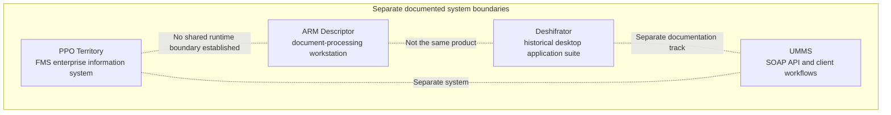
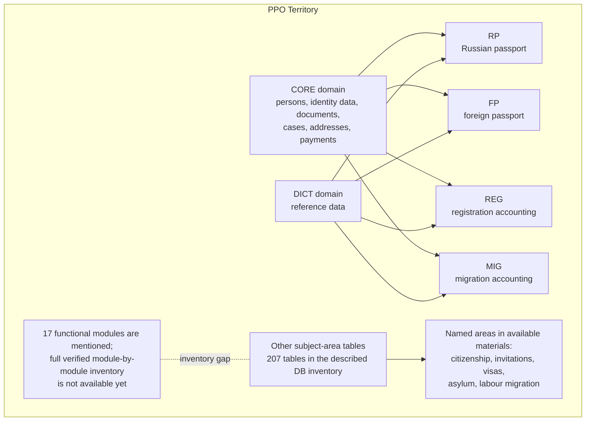
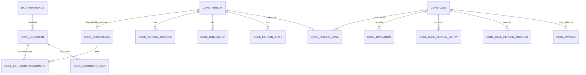
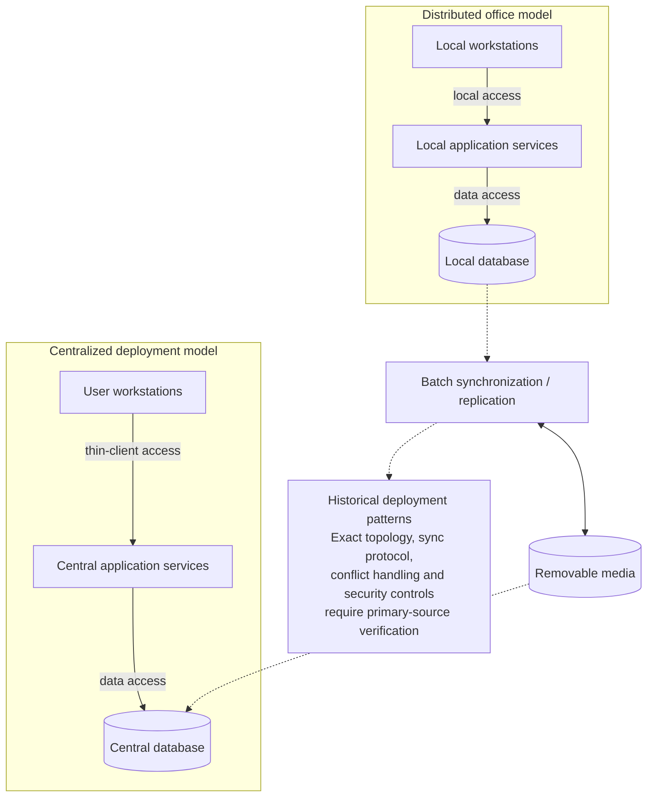
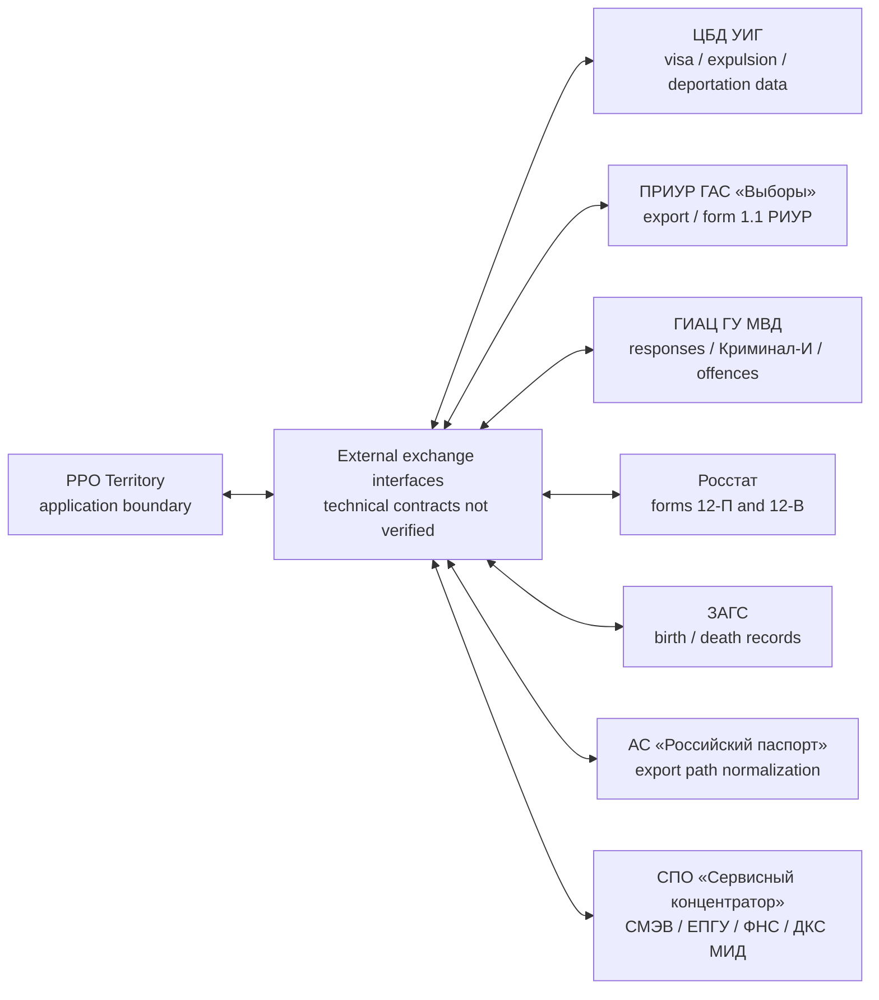
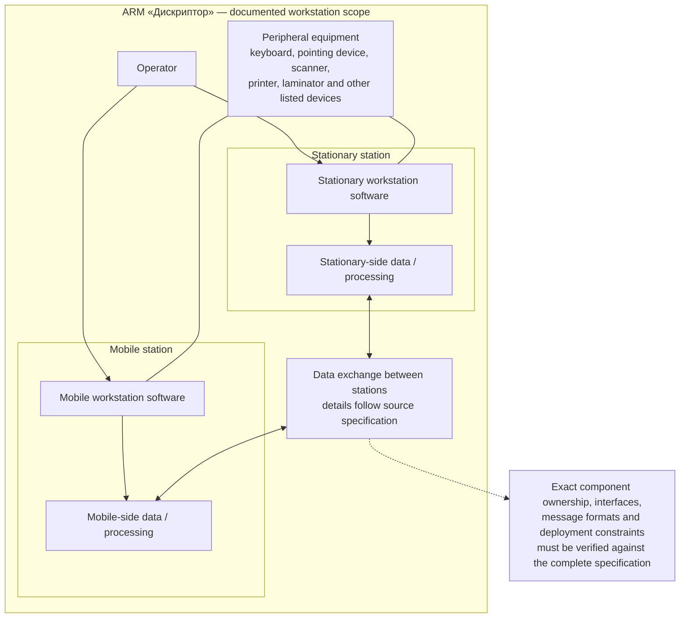
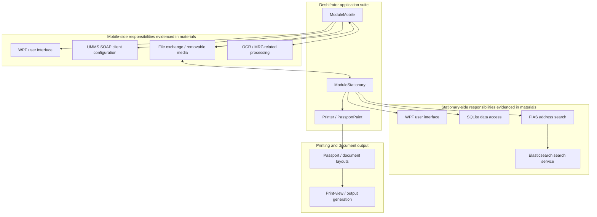
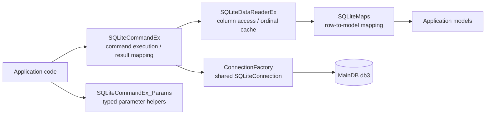
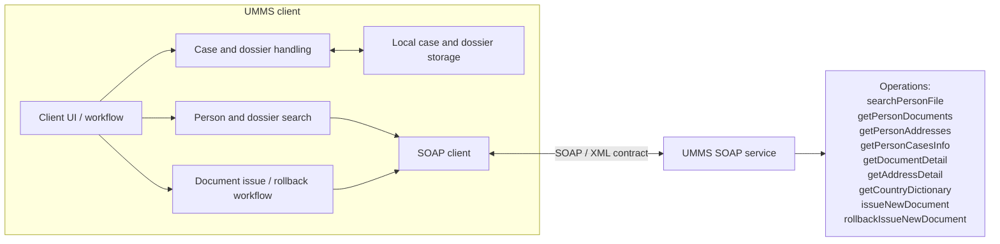
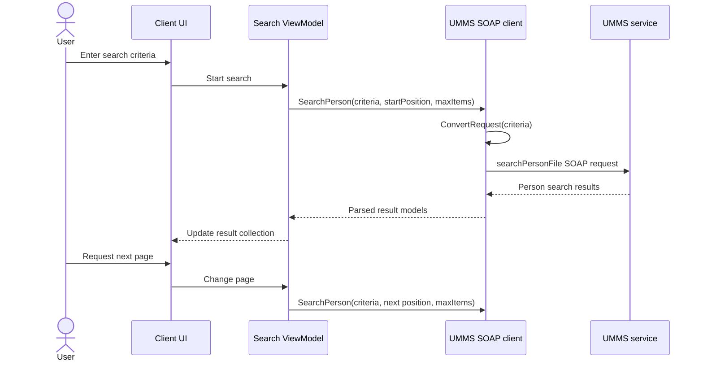

# Architecture catalogue — Territory, Descriptor, Deshifrator and UMMS

> **Evidence-based portfolio documentation.** This catalogue separates four independently documented systems and their component boundaries. It consolidates the architecture views that can be supported by the currently published source materials. It is not a claim that the systems form one deployed product.

## How to read these diagrams

- **Documented** — directly stated in the available project documentation or visible in inspected source excerpts.
- **Derived view** — a logical grouping of documented elements for readability; it is not a recovered deployment configuration.
- **Unverified** — exact protocols, endpoints, ownership, runtime topology, or internal module responsibilities are not established by the available evidence.
- The 17-module count for PPO Territory is mentioned in source materials, but a complete authoritative list of all 17 modules has not been reconstructed. Unknown modules are intentionally not invented.
- ARM «Дискриптор», Deshifrator, PPO Territory, and UMMS are kept as separate system boundaries. Similar terms do not prove that they are one product.

---

## 1. System landscape and boundaries

## 2. PPO Territory — functional module map

**Inventory notes.** The database overview reports 401 tables: 44 `CORE_*`, 104 `DICT_*`, 11 `RP_*`, 10 `FP_*`, 17 `REG_*`, 8 `MIG_*`, and 207 in other subject areas. The named subject areas above are not a verified one-to-one list of the 17 functional modules. Table counts are database inventory data, not module counts.

## 3. PPO Territory — logical data architecture

**Model interpretation.** The ER view is a conceptual summary of documented table roles, not a fully validated physical ERD. The exact foreign-key cardinalities, optionality, and module-specific extension tables must be checked against the physical Oracle schema. `DICT_REFERENCE` is a logical placeholder for multiple dictionary tables, not a literal table name.

## 4. PPO Territory — deployment architecture

## 5. PPO Territory — external integration landscape

The diagram shows seven documented **exchange directions**, not verified live integrations. Protocols, endpoints, authentication, message schemas, ownership of each adapter, and current operational status are not established.

## 6. ARM «Дискриптор» — workstation and hardware/software boundary

This is a system decomposition from the ARM description: stationary and mobile stations, user interaction, peripherals, and an exchange boundary. It does not assert a specific network protocol or a particular physical connection for every peripheral.

## 7. Deshifrator — application suite and component architecture

**Boundary warning.** The relationships above summarize documented suite roles and available package/source observations. They do not establish that every feature is implemented in the same executable, nor do they imply that ARM «Дискриптор» is this application.

## 8. Deshifrator — SQLite data-access component view

The component names and responsibilities are based on reviewed C# excerpts. Connection lifetime, concurrency, disposal, null handling, and reader behavior are recorded as review findings in the data-access review; this diagram does not imply those risks have been resolved.

## 9. UMMS — client and SOAP service boundary

### 9.1 SOAP search request sequence

The operation names are taken from the public API description and source-review notes. Exact SOAP envelopes, namespaces, SOAPAction values, schemas, authentication, error contracts, and endpoint details must be verified against the WSDL and approved integration documentation.

---

## 10. Coverage and remaining verification

| System / area | Architecture views included | Remaining evidence needed |
|---|---|---|
| PPO Territory | Functional domains, conceptual data model, deployment, seven exchange directions | Authoritative list of all 17 modules; complete physical ERD; adapter contracts; deployment diagrams and synchronization rules |
| ARM «Дискриптор» | Stationary/mobile workstation decomposition, peripherals, exchange boundary | Full component inventory, hardware mapping, interface/control descriptions, verified data-flow details |
| Deshifrator | ModuleMobile, ModuleStationary, Printer/PassportPaint, SQLite DAL | Complete source tree, project references, executable ownership per feature, full schema and runtime configuration |
| UMMS | Client/service boundary, SOAP operations, search sequence | WSDL/XSD, exact service contract, full client source, deployment and security configuration |

## 11. Evidence and change policy

1. Do not merge these four system boundaries into one runtime architecture without explicit evidence.
2. Do not invent names or responsibilities for the unverified Territory modules.
3. Do not publish production endpoints, credentials, personal data, keys, or real exchange files.
4. Treat modernization ideas as proposals unless a completed implementation is evidenced.
5. Update a diagram only when a source document, code excerpt, schema, test, or deployment artifact supports the change.
