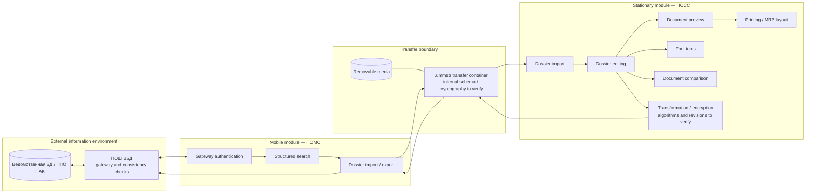
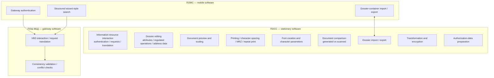
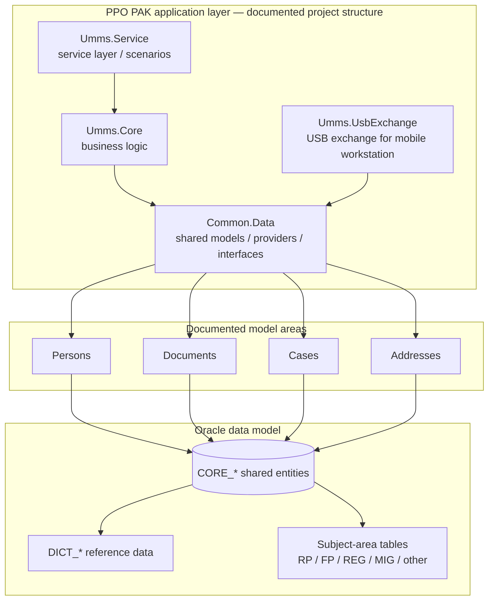
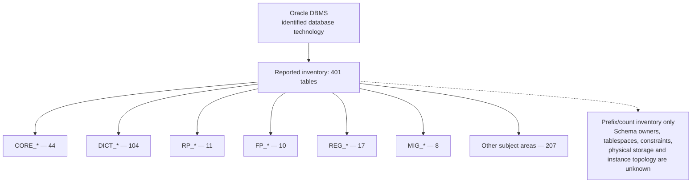
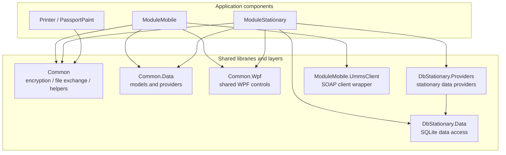
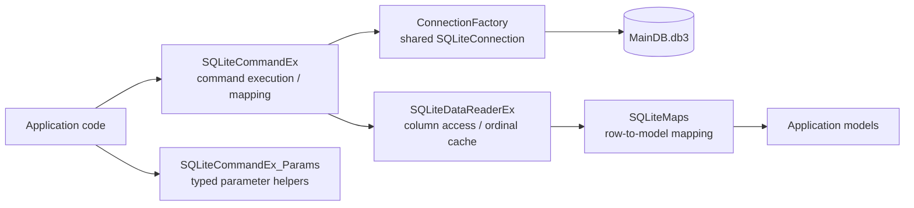
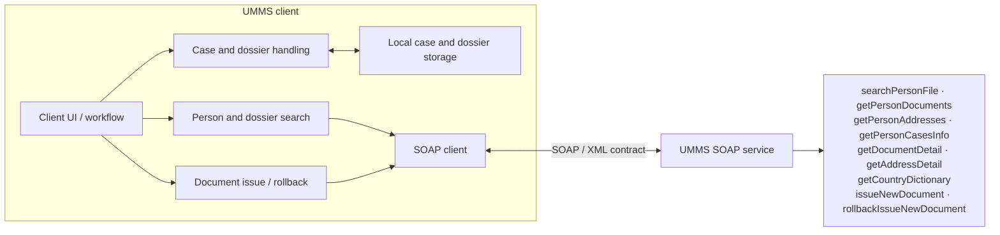
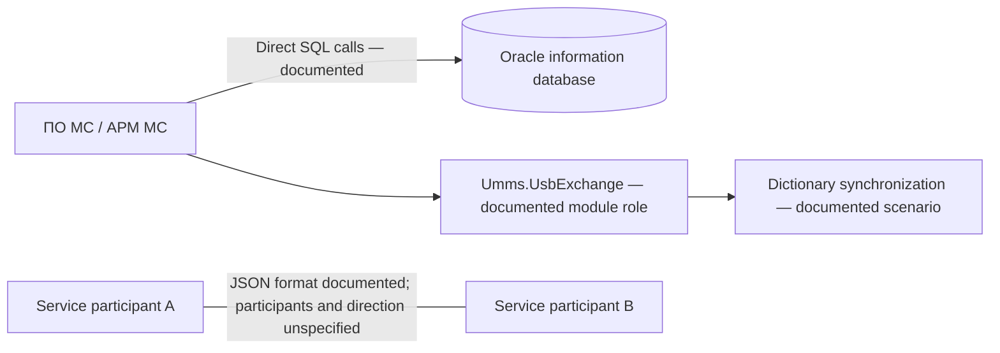
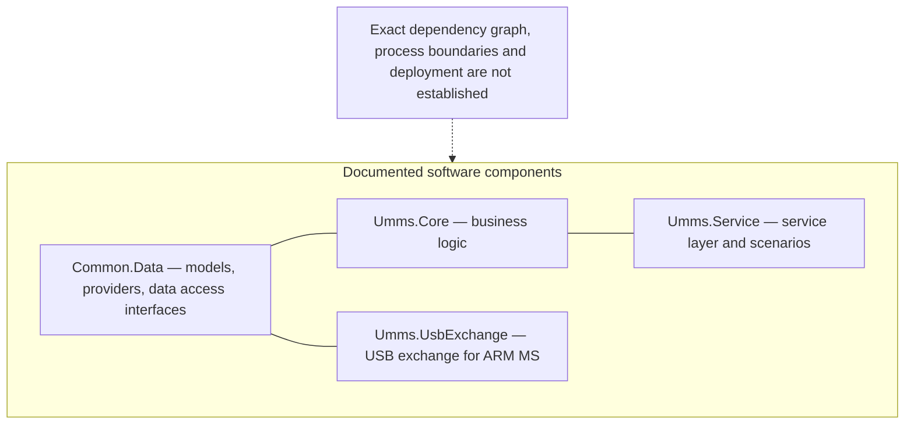
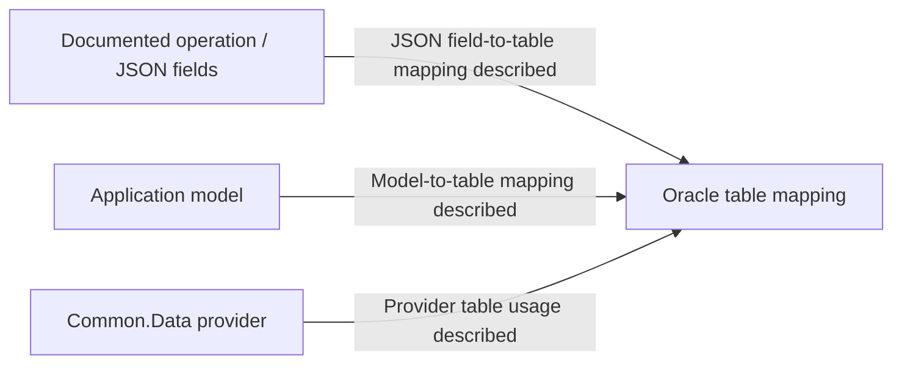

# Component maps — detailed architecture views

> Companion to the [canonical architecture catalogue](./README.md) and its [interactive bilingual HTML view](./architecture.html). This file contains 7 detailed Mermaid diagrams. The PPO PAK SQLite data-access diagram is expanded in the [standalone source review](https://ekatmoz88-alt.github.io/github-profile-dashboard-vite/docs/sqlite-data-access-review.html). These diagrams expand the module and component views of the PPO PAK information system and the Dossier Processing Workstation as distinct application boundaries within the same project; UMMS is shown separately where relevant. The diagrams are logical architecture views and do not reconstruct the physical topology of every individual installation. For a separate reconstruction of the supplied Visio and presentation diagrams (including the exact 11/6/5 functional-block inventory, 9/3/4 software-module views, trust-level variants and dossier lifecycle), see [ППО ПАК и АРМ обработки досье — реконструкция по первичным схемам](./PPO PAK-14-source-reconstruction.ru.md).

## 1. Dossier Processing Workstation — architecture and trust boundaries (historical source label: ARM «ППО ПАК»)

The source specification describes three logical zones: external VBD/gateway, mobile module, and stationary module. It also describes removable-media transfer, `.ummstr` files, gateway authentication, dossier search, editing, preview, printing, font tools, comparison, and consistency checks. Exact trust-zone enforcement and cryptographic allocation must be verified against the original technical-project revision and implementation evidence.

### Dossier Processing Workstation — functional areas

These are the functional areas enumerated in the specification, not a verified executable/module breakdown. The source describes nine ПОСС areas, three ПОМС areas, and two gateway areas.

## 2. PPO PAK — software component architecture

The project names and model areas come from the published PPO PAK source-code overview. This is a logical view: it does not assert that every project directly connects to Oracle or that the `Umms.*` projects implement the separately documented UMMS SOAP service/client. The Oracle DBMS and table inventory shown here belong to the PPO PAK source context; the independent Oracle DMRS / GLOBAL11 project is separate and is not represented by this diagram.

### PPO PAK — database inventory (Oracle DBMS; not a deployment diagram)

The PPO PAK database overview identifies Oracle as its DBMS and reports 401 tables. A separate physical specification contains 381 numbered entries; the counts come from different source documents and have not been reconciled. This does not refer to the independent Oracle DMRS / GLOBAL11 project. Prefixes are not assumed to be Oracle schema owners. This diagram is a database inventory view, not an ERD and not a deployment view. To build the physical schema map, inspect DDL or permitted Oracle dictionary metadata for owners, objects, columns, constraints, views, PL/SQL units, triggers, and dependencies. Do not use production rows or secrets.

## 3. Dossier Processing Workstation — application suite and shared libraries

Component names and relationships are based on the published application-suite review and selected source excerpts. A direct runtime call from ModuleMobile or ModuleStationary to Printer/PassportPaint is not established by the reviewed fragments; this is a project-level grouping, not a verified process-call graph.

### Dossier Processing Workstation — SQLite data-access path

## 4. UMMS — client workflow and service operations

Exact SOAP envelopes, namespaces, SOAPAction values, schemas, authentication, error contracts, and endpoint details require verification against the WSDL and approved integration documentation.

## 5. Evidence limitations

- The complete authoritative list of the 17 PPO PAK functional modules is not available in the current source set.
- The Dossier Processing Workstation diagrams reflect specified logical functions and trust boundaries; they do not independently prove implementation.
- Dossier Processing Workstation diagrams are limited to the application suite and source excerpts that have been reviewed.
- UMMS API operation names are documented; complete wire-level contracts and deployment details are not included.
- Treat PPO PAK as the umbrella project containing the PPO PAK information system and the Dossier Processing Workstation; retain their distinct application and runtime boundaries. The historical label ARM «ППО ПАК» refers to the Dossier Processing Workstation, not to another project.
- Keep the independent Oracle DMRS / GLOBAL11 project outside the PPO PAK documentation. Do not confuse it with the Oracle DBMS identified in PPO PAK database materials.
- Draw a runtime integration only when primary evidence establishes it.

## 6. PPO ID Docs — documented exchange context and traceability

The following source diagrams preserve the documented exchange and code-to-database relationships from the earlier PPO ID documentation set. They describe documentary evidence, not a verified runtime topology.

### 6.1 Exchange context

Direct SQL calls from the mobile workstation and JSON-formatted service exchange are stated in the source documentation. The exact service participants, message direction, deployment topology and synchronization implementation are not established by this diagram.

### 6.2 Documented software component inventory

The component names and roles are documented. The connectors above are only a grouping view; they do not assert a complete dependency graph or direct runtime calls.

### 6.3 API-to-database traceability

The source materials describe field-to-table, model-to-table and provider-to-table traceability. They do not establish that every operation follows one universal call chain. For table-group classification, see the [editable Draw.io source](../territory-database/database/diagrams/oracle-table-groups.drawio) and [published Oracle table-groups diagram](../territory-database/database/oracle-table-groups.html).
