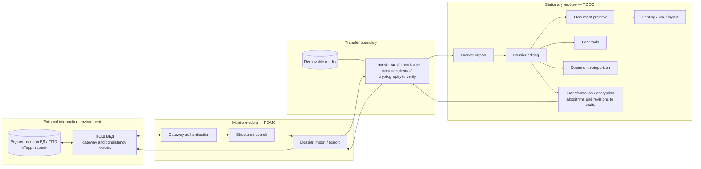
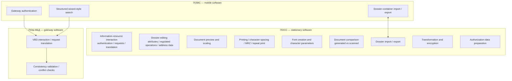
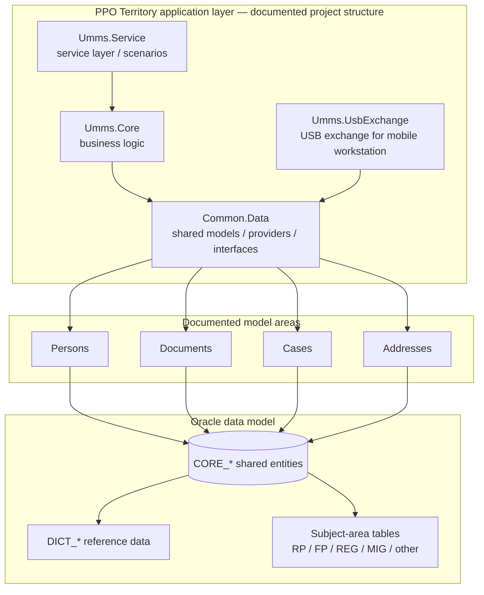
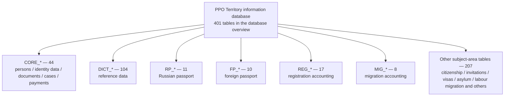
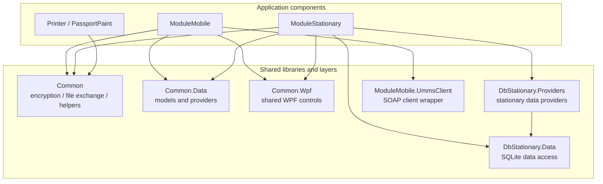
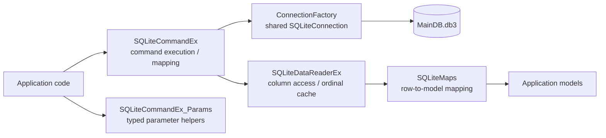
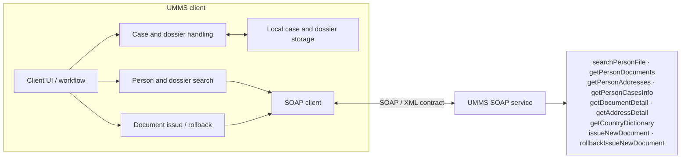

# Component maps — detailed architecture views

> Companion to [Architecture catalogue](./README.md). These diagrams expand the module and component views using the currently published documentation. They are logical reconstructions, not proof of current deployment.

## 1. ARM «Дискриптор» — logical architecture and trust boundaries

The source specification describes three logical zones: external VBD/gateway, mobile module, and stationary module. It also describes removable-media transfer, `.ummstr` files, gateway authentication, dossier search, editing, preview, printing, font tools, comparison, and consistency checks. Exact trust-zone enforcement and cryptographic allocation must be verified against the original technical-project revision and implementation evidence.

### ARM Descriptor — functional areas

These are the functional areas enumerated in the specification, not a verified executable/module breakdown. The source describes nine ПОСС areas, three ПОМС areas, and two gateway areas.

## 2. PPO Territory — software component architecture

The project names and model areas come from the published source-code overview. This is a logical view: it does not assert that every project directly connects to Oracle or that these `Umms.*` projects are the same as the separate UMMS SOAP service/client repository. Verify project references and runtime hosting against solution files and deployment configuration.

### PPO Territory — subject-area and database inventory

The inventory groups table prefixes and counts from the database overview. It must not be confused with the separate statement that the application has 17 functional modules; the authoritative module-by-module list is still incomplete.

## 3. Deshifrator — application suite and shared libraries

Component names and relationships are based on the published application-suite review and selected source excerpts. A direct runtime call from ModuleMobile or ModuleStationary to Printer/PassportPaint is not established by the reviewed fragments; this is a project-level grouping, not a verified process-call graph.

### Deshifrator — SQLite data-access path

## 4. UMMS — client workflow and service operations

Exact SOAP envelopes, namespaces, SOAPAction values, schemas, authentication, error contracts, and endpoint details require verification against the WSDL and approved integration documentation.

## 5. Evidence limitations

- The complete authoritative list of the 17 PPO Territory functional modules is not available in the current source set.
- The ARM Descriptor diagrams reflect specified logical functions and trust boundaries; they do not independently prove implementation.
- Deshifrator diagrams are limited to the application suite and source excerpts that have been reviewed.
- UMMS API operation names are documented; complete wire-level contracts and deployment details are not included.
- Keep all system boundaries separate unless primary evidence establishes an actual integration.