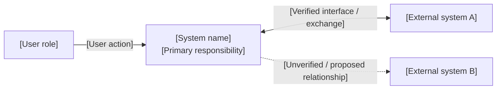
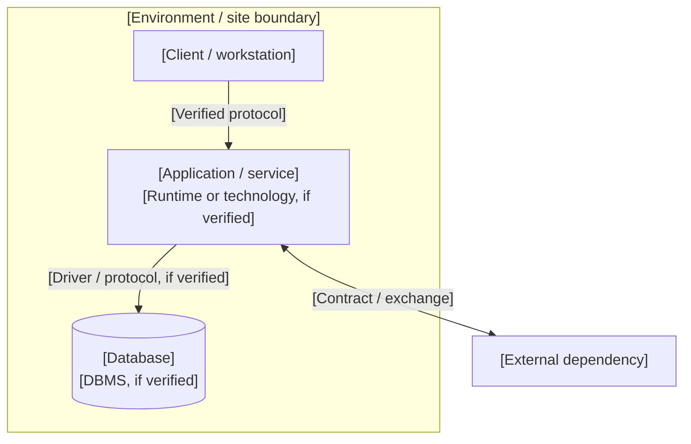
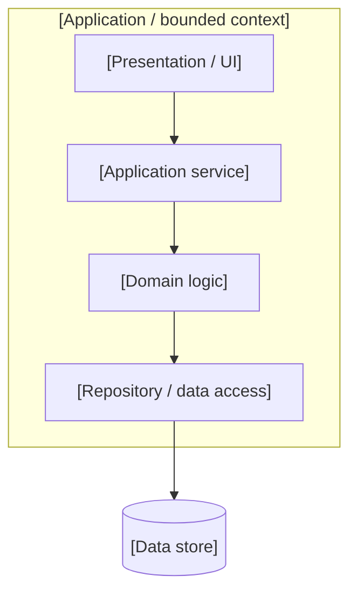
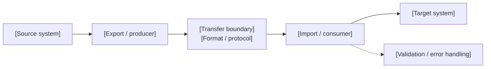
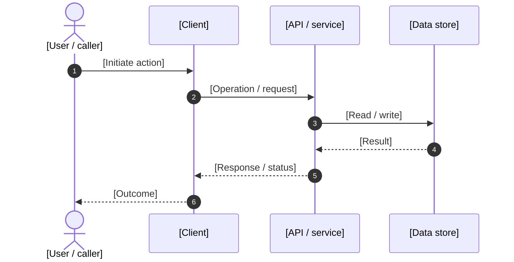
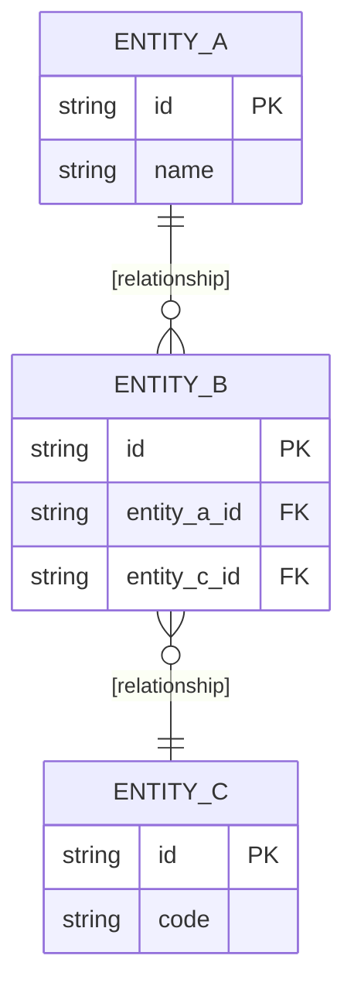
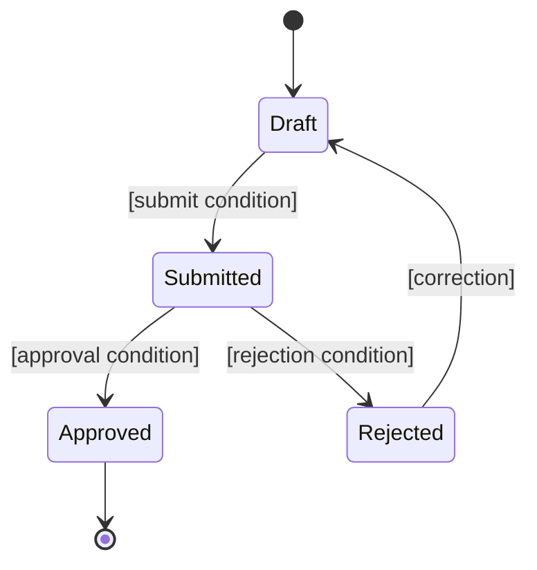
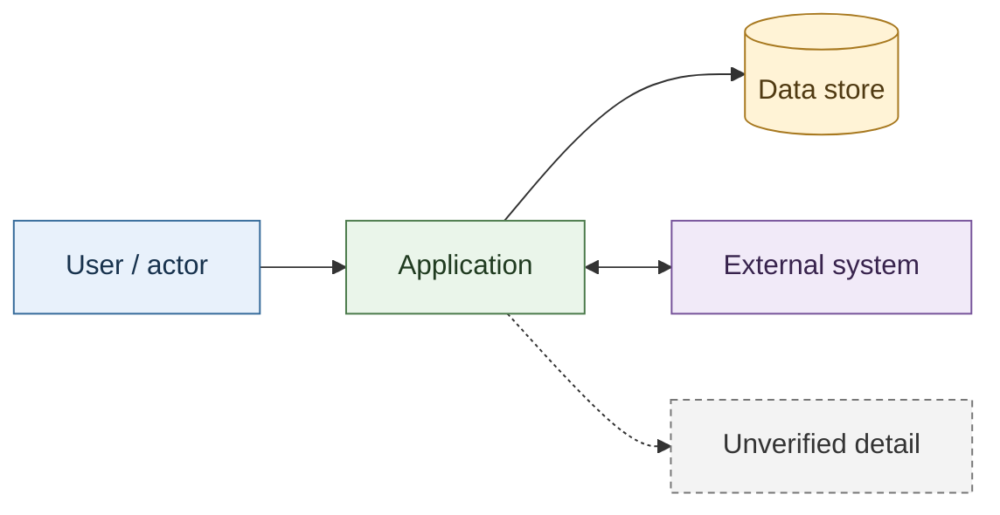

# Mermaid diagram patterns and reusable templates

> **Purpose / Назначение:** a copy-and-adapt library of Mermaid patterns for enterprise technical documentation. Mermaid does not provide user-defined callable macros; these files are reusable templates/snippets, not executable macros.
>
> **How to use:** copy a fenced `mermaid` block, replace the clearly marked placeholders, keep only relationships supported by evidence, then render it in the architecture catalogue.

## 1. Conventions

- Use stable, descriptive node IDs in `UPPER_SNAKE_CASE`; keep display labels readable.
- One diagram should answer one architectural question.
- Label every cross-system edge with the actual interface or exchange mechanism. If unknown, label it `[protocol to verify]` rather than guessing.
- Use subgraphs for ownership or trust boundaries, not merely to group visually related nodes.
- Distinguish documented facts from derived views and unverified details in the surrounding prose.
- Avoid production secrets, personal data, real credentials, and sensitive endpoint values.
- Keep line breaks in labels as ` `; quote labels containing punctuation or special characters.
- Prefer a small number of meaningful edge types. Explain dotted/dashed relationships in a legend.

## 2. System context / system boundary

Use when documenting a system, its users, and external actors. Replace all bracketed labels.

## 3. Container / deployment view

Use for deployable applications, services, databases, and infrastructure boundaries. Do not imply a deployment topology unless a deployment source supports it.

## 4. Component map

Use to show responsibilities inside one application or bounded component. Keep the diagram at one level of detail.

## 5. Data flow / exchange

Use to document a file, message, or API exchange. Name formats and transfer mechanisms only when verified.

## 6. Sequence / API interaction

Use for request-response flows. Replace operations with names from the actual API contract; mark asynchronous behavior explicitly.

## 7. Entity relationship model

Use for conceptual or physical data models. Mark the model type in the title/caption. Do not present inferred links as verified foreign keys.

## 8. State machine

Use when documenting lifecycle states and allowed transitions. Include only states and transitions supported by a specification or observed implementation.

## 9. Standard styling fragment

Copy the `classDef` declarations into a diagram when consistent visual roles help readability. Assign classes only where the meaning is clear.

## 10. Review checklist

- [ ] The diagram has a clear title and one purpose.
- [ ] System and trust boundaries are explicit.
- [ ] Every arrow has a meaningful direction and, where needed, a label.
- [ ] Protocols, formats, technologies, and cardinalities are evidence-backed.
- [ ] Inferred or unverified relationships are visibly distinguished.
- [ ] Node IDs are unique and labels are concise.
- [ ] The Mermaid block renders in the repository's Mermaid 11 catalogue.
- [ ] The surrounding text states source, scope, limitations, and verification gaps.

## 11. Project-specific usage

For this repository, keep PPO Territory, ARM «Дискриптор», Deshifrator, UMMS, and supplementary source systems as separate boundaries unless evidence explicitly demonstrates an integration. Reuse the patterns above to create consistent views; do not copy example entities or relationships as facts about the documented systems.

**Related:** [Architecture catalogue](./README.md) · [Interactive EN/RU diagrams](./architecture.html) · [Component maps](./component-maps.md)
