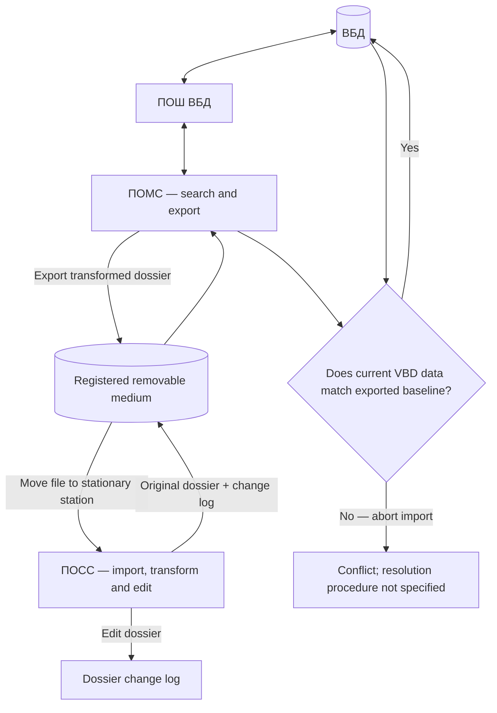

# ARM Descriptor — Data Exchange, Transfer Workflow and Formats

## Scope and evidence status

This page consolidates the supplied technical-description workflow for ПОМС, ПОСС, the VBD gateway and removable-media transfer. It describes specified behavior. It does not prove that every requirement was implemented in a particular software build.

## System participants

- **ВБД** — departmental database containing dossier information.
- **ПОШ ВБД** — gateway software used by the mobile station to interact with the departmental database.
- **ПОМС** — mobile-station software used to search and select dossiers and submit approved changes.
- **ПОСС** — stationary-station software used to view, edit and prepare dossier/document data.
- **Учтённый носитель информации** — registered/controlled removable storage medium used to transfer files between mobile and stationary stations.

## End-to-end workflow

1. The mobile-station user connects ПОМС to ПОШ ВБД.
2. The user searches the VBD using the available dossier filters.
3. The user selects one or more dossiers for processing at the stationary station.
4. ПОМС exports the selected dossier data from the VBD, transforming it into the file representation used by ПОСС.
5. The user connects the mobile station to the stationary station using a registered storage medium.
6. The transformed dossier file is moved from ПОМС to the registered medium. The source text explicitly describes a move, not a copy.
7. The stationary-station user imports the file from the registered medium. The source again describes a move; the information is then stored only on the stationary station.
8. ПОСС transforms the imported file representation into dossier records that can be viewed and edited.
9. The stationary-station user processes the dossier. Changes are recorded in a dossier change log.
10. ПОСС exports the original dossier and its change log back to ПОМС, using the registered medium.
11. The mobile-station user selects the changes to submit to the VBD.
12. Before import, ПОМС checks whether the source VBD data has changed since the original export.
13. If the VBD source data differs from the exported baseline, import is aborted. If it matches, the changed data is imported into the VBD.

## Workflow diagram

The diagram is a logical reconstruction of the textual workflow. It does not define transaction boundaries or internal file formats.

## Search criteria supported by the mobile-station filter

- Date of birth: from/to.
- Date of death: from/to, optional.
- Sex: male/female.
- Place of birth: optional.
- Full name: optional.
- Document data: document type, issuing authority, series and number, issue-date range, document indicator and optional reason for documentation. Multiple document filters may be specified.
- Address data: address type, optional effective date, locality, street and optional premises. Multiple address filters may be specified.

The source does not define exact matching semantics, normalization rules, pagination, query limits or performance characteristics.

## Per-dossier processing metadata

The source states that each dossier is associated with:
- date and time of export from ПОМС;
- date and time of export from ПОСС to ПОМС;
- date and time of loading from ПОМС to ПОСС;
- date and time of loading from ПОМС;
- dossier change log;
- information about users who performed actions on the dossier.

The exact event semantics and timestamp authority/time zone are not specified. The original wording is retained as separate event labels; they should not be collapsed into a single generic timestamp.

## Optimistic consistency check

The pre-import comparison is a form of optimistic concurrency control: the source record is compared with the baseline exported for editing. If the source has changed, the import is rejected rather than overwriting newer source data.

The source does not identify the comparison key or mechanism (row version, timestamp, hash, field-by-field comparison, or another method), nor does it specify merge, retry, conflict review or audit behavior after rejection.

## Transfer container and format evidence

The interface materials show the `.ummstr` extension and the description “UMMSTR (Umms transfer file)”. This confirms a user-facing export option, not the internal container schema or cryptographic implementation.

The source describes conversion between the mobile transfer representation and the stationary dossier representation. Exact serialization format, schema versioning, character encoding, compression, encryption, integrity protection and compatibility rules require source-code or file-level inspection.

## Font configuration XML

The described `DescriptorFont` structure includes:
- `Name`;
- `Dpi` (120 shown as a baseline);
- `CharSpacing`;
- `CharPairSpacings` with `FirstChar`, `SecondChar` and `Spacing`;
- `CharBaselineShifts` for baseline adjustments.

Examples mention Cyrillic characters Ц, Щ and Д.

## Important distinction from PPO Territory's own exchange mechanism

PPO Territory documentation separately describes encoded and compressed internal export files and a file-marker mechanism for preventing concurrent duplicate imports. Those details must not automatically be attributed to the ARM Descriptor `.ummstr` workflow. The two mechanisms have not been proven to be the same implementation.

## Open verification items

- Actual `.ummstr` schema, versioning and serialization.
- Whether file transfer uses move semantics in every implementation path.
- Encryption, compression, integrity checks and key management.
- Registered-media identification and audit.
- Exact baseline-comparison algorithm.
- Conflict resolution and re-submission procedure.
- Transaction boundaries and recovery after interruption.
- Timestamp source, precision and time-zone handling.
- Whether deleted/moved files are securely removed from source media.

## Related documents

- [System Design](01-system-design.md)
- [Functional Subsystems](02-functional-subsystems.md)
- [Hardware and Software](03-hardware-software.md)
- [Security Architecture](07-trust-levels-security-architecture.md)
- [Dossier Processing Workflow and Metadata](08-data-processing-workflow.md)
- [Software Components and Workstation Equipment](09-components-and-workstation-equipment.md)

## Additional dossier transfer workflow and metadata

The supplied specification describes the following sequence: ПОМС connects to ПОШ ВБД; searches using filters; selects dossiers; exports and transforms them for ПОСС; moves the file through registered removable media; ПОСС imports and converts the dossier for viewing/editing; the stationary user edits it and produces a change log; ПОСС returns the original dossier and change log through the registered medium; ПОМС checks whether the VBD source data has changed since export; if it has changed, import is aborted, otherwise the changes are submitted.

The mobile filter includes birth-date range, optional death-date range, sex, optional place of birth and name, multiple document filters (type, issuing authority, series/number, issue-date range, indicator and optional reason), and multiple address filters (type, optional effective date, locality, street and optional premises).

Each dossier is stated to carry four separate date/time events: export from ПОМС; export from ПОСС to ПОМС; loading from ПОМС to ПОСС; and loading from ПОМС. It also carries the dossier change log and information about users who performed actions.

The pre-import comparison is logically an optimistic concurrency check. The source does not identify whether it compares versions, timestamps, hashes or field values, and does not define conflict resolution or retry behavior. See [Dossier Processing Workflow and Metadata](08-data-processing-workflow.md) for the full sequence and verification questions.
