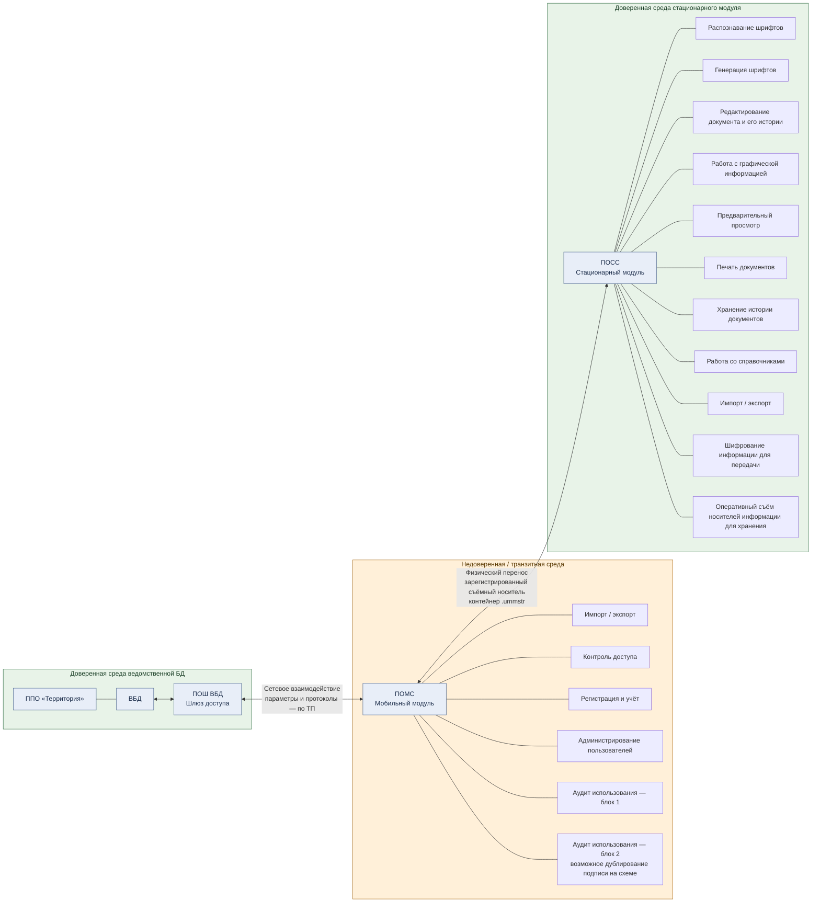

# АРМ «Дискриптор» — уровни доверия и архитектура безопасности

> **Статус источника.** Документ структурирует транскрипцию предоставленной схемы разработчика и сведения, переданные для анализа. Это не независимое подтверждение фактической реализации всех перечисленных механизмов. Формулировки, требующие проверки по оригиналу ТП, исходному коду, конфигурации или испытаниям, отмечены отдельно.

## 1. Назначение и границы

Документ описывает разделение комплекса на три зоны доверия и функциональные блоки стационарного и мобильного модулей, а также положение шлюза доступа к ведомственной базе данных.

В репозитории уже существует документ [04 — Data Exchange and Formats](04-data-exchange.md). Чтобы не перезаписывать его и не нарушать существующие ссылки, архитектура безопасности добавлена как документ **07**.

Термины:
- **ППО «Территория»** — внешняя по отношению к АРМ система, связанная с ведомственной базой данных.
- **ВБД** — ведомственная база данных.
- **ПОШ ВБД** — программное обеспечение шлюза доступа к ВБД.
- **ПОМС** — программное обеспечение мобильного модуля.
- **ПОСС** — программное обеспечение стационарного модуля.
- **АРМ «Дискриптор»** — комплекс, включающий мобильный и стационарный модули.

## 2. Модель зон доверия

В транскрипции схемы разработчика выделены три среды:

1. **Доверенная среда стационарного модуля** — ПОСС и локальная база данных. В ней выполняются локальная обработка досье, редактирование, ведение истории и подготовка документов к печати.
2. **Недоверенная (транзитная) среда мобильного модуля** — ПОМС. Мобильный компонент рассматривается проектной моделью как отдельная зона с более низким уровнем доверия.
3. **Доверенная среда ведомственной базы данных** — ВБД и ПОШ ВБД, обеспечивающий доступ к ведомственным данным.

Слово «доверенная» здесь обозначает классификацию в модели проекта, а не доказательство отсутствия уязвимостей или абсолютной защищённости компонентов.

## 3. Архитектурная схема

Схема показывает сетевое взаимодействие мобильного модуля со шлюзом ВБД и отдельный физический канал обмена между мобильным и стационарным модулями. Прямой канал между двумя доверенными средами не изображён: в описании исходной схемы он указан как запрещённый. Это положение следует сверить с оригиналом технического проекта.

**Интерпретация линий:**
- Между ПОШ ВБД и ПОМС показано сетевое взаимодействие. Конкретные протоколы, порты и криптографические параметры следует приводить только в соответствии с соответствующим разделом ТП и подтверждёнными конфигурациями.
- Между ПОМС и ПОСС показан физический перенос данных на зарегистрированном съёмном носителе. В описании обмена упоминается контейнер `.ummstr`.
- Прямая линия ВБД/ПОШ ВБД — ПОСС отсутствует. В предоставленной транскрипции запрет прямого взаимодействия сформулирован как проектное правило.

## 4. Функциональные блоки стационарного модуля

По транскрипции схемы разработчика стационарный модуль включает 11 блоков:

| № | Наименование блока | Заявленная функция |
|---:|---|---|
| 1 | Распознавание шрифтов | Анализ входящих начертаний |
| 2 | Генерация шрифтов | Формирование пользовательских библиотек символов |
| 3 | Редактирование документа и его истории | Изменение документа и связанных с ним сведений |
| 4 | Работа с графической информацией | Обработка графических материалов, подложек и сканов |
| 5 | Предварительный просмотр | Просмотр макета перед печатью |
| 6 | Печать документов | Вывод подготовленных документов на печать |
| 7 | Хранение истории документов | Хранение сведений об операциях с документами |
| 8 | Работа со справочниками | Работа с локальными справочниками, включая ФИАС (если подтверждено ТП) |
| 9 | Импорт / экспорт | Обмен данными и обработка контейнеров |
| 10 | Шифрование информации для передачи | Защита передаваемых данных |
| 11 | Оперативный съём носителей информации для хранения | Операции с физическими носителями информации |

Названия сохранены по предоставленной транскрипции. Точное назначение, состав операций и соответствие программным классам/исполняемым компонентам требуют сверки с оригиналом схемы и исходным кодом.

## 5. Функциональные блоки мобильного модуля

По транскрипции схемы разработчика мобильный модуль включает шесть подписей функциональных блоков:

| № | Наименование блока | Заявленная функция |
|---:|---|---|
| 1 | Импорт / экспорт | Обмен данными со шлюзом и стационарным модулем |
| 2 | Система контроля доступа | Аутентификация операторов мобильной станции |
| 3 | Регистрация и учёт | Учёт извлечённых досье и операций |
| 4 | Администрирование пользователей | Управление пользователями и ролями |
| 5 | Аудит использования | Регистрация действий и событий |
| 6 | Аудит использования (повторная подпись) | На исходной схеме, по транскрипции, повторяется подпись блока аудита |

Повторная подпись не трактуется как доказательство существования двух независимых подсистем аудита. До изучения оригинального изображения её следует учитывать как возможное дублирование подписи при оформлении схемы. Утверждение о неизменяемости журнала требует отдельного технического подтверждения.

Указанные в материалах роли «Оператор МС» и «Администратор МС» следует считать проектными наименованиями до сверки с матрицей ролей и реализацией.

## 6. Транзитный обмен и защитные механизмы

В предоставленном описании архитектурная логика обмена состоит в следующем:

1. ПОМС взаимодействует с ПОШ ВБД для получения или передачи предусмотренных проектом данных.
2. Обмен между ПОМС и ПОСС выполняется через зарегистрированные съёмные носители.
3. Для передачи между средами используются файлы-контейнеры с расширением `.ummstr`.
4. В транскрипции указано шифрование передаваемой информации с упоминанием AES и ГОСТ 28147-89.

Наличие расширения `.ummstr` само по себе не раскрывает структуру контейнера, алгоритм шифрования, режим работы, способ управления ключами, проверку целостности или защиту от повторного воспроизведения. Также нельзя без дополнительных материалов утверждать, что оба названных алгоритма применяются одновременно либо на одном и том же уровне.

## 7. Границы доказуемых утверждений

| Утверждение | Что подтверждает предоставленная транскрипция | Что нужно для технического подтверждения |
|---|---|---|
| В проекте выделены три зоны доверия | Описание схемы уровней доверия | Оригинал схемы, лист и обозначение документа ТП |
| ПОМС относится к транзитной/недоверенной среде | Подпись и описание зоны в транскрипции | Оригинал схемы и раздел ТП о модели угроз |
| Прямой обмен между ВБД и ПОСС запрещён | Такое правило приведено в текстовом описании | Оригинальная схема, требования к интерфейсам, сетевые правила и конфигурации |
| Обмен ПОМС—ПОСС выполняется через съёмный носитель | Описание физического переноса | Регламент обмена, форматы носителей, журналы и результаты испытаний |
| Используется шифрование AES / ГОСТ 28147-89 | Алгоритмы названы в переданной транскрипции | Исходный код, криптопровайдер, конфигурация, спецификация контейнера и тесты |
| Журнал аудита неизменяемый | Транскрипция упоминает аудит | Механизм защиты от изменения/удаления, права доступа, хранение и тесты |
| Компрометация ПОМС не даёт сквозного доступа к другим зонам | Это заявленная цель архитектурного разделения | Модель угроз, анализ путей доступа, тесты изоляции и результаты испытаний |

## 8. Связанные документы

- [01 — System Design](01-system-design.md)
- [02 — Functional Subsystems](02-functional-subsystems.md)
- [04 — Data Exchange and Formats](04-data-exchange.md)
- [05 — Mobile Station UI](05-mobile-station-ui.md)
- [Verification Matrix](../evidence/verification-matrix.md)

## 9. Открытые вопросы для сверки с первоисточником

- Полное наименование, шифр, редакция и лист исходной схемы уровней доверия.
- Точные названия зон и подписи стрелок на оригинальном чертеже.
- Является ли повтор «Аудит использования» артефактом отрисовки или обозначает отдельный блок.
- Какие именно протоколы и порты используются между ПОМС и ПОШ ВБД.
- Где и каким компонентом выполняется шифрование контейнера `.ummstr`.
- Как реализованы регистрация носителей, контроль импорта и защита журналов аудита.
- Какие утверждения подтверждены ТП, а какие — исходным кодом и испытаниями.

---

**Примечание о доказательственной ценности.** Документ является аналитической транскрипцией предоставленного материала. Он не заменяет оригинальный чертёж, заверенную копию ТП, протоколы испытаний или экспертное заключение и не должен описываться как самостоятельное доказательство подлинности либо фактической реализации функций.
