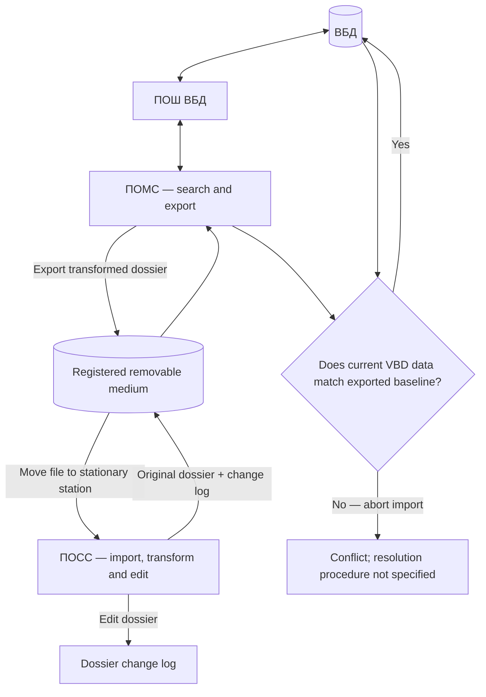

# ARM Descriptor — Dossier Processing Workflow and Metadata

## Scope

This document describes the dossier processing sequence specified for ПОМС (mobile station), ПОСС (stationary station), ПОШ ВБД (departmental database gateway) and the VBD. It is a requirements-level workflow, not proof of implementation.

## Actors and systems

- Mobile-station operator.
- ПОМС.
- ПОШ ВБД.
- ВБД.
- Registered removable storage medium.
- ПОСС.
- Stationary-station operator.

## Workflow

1. The mobile-station user connects ПОМС to ПОШ ВБД.
2. The user searches the VBD with a structured filter.
3. The user selects a dossier or group of dossiers for processing on ПОСС.
4. ПОМС exports selected dossiers from the VBD and transforms them into the file representation used by ПОСС.
5. The user connects the mobile station to the stationary station using a registered removable medium.
6. The dossier file is moved from the mobile station to the registered medium.
7. The stationary-station user imports the file from the medium. The source describes the operation as a move, not a copy, and states that the information is stored only on the stationary station.
8. ПОСС converts the imported file representation into dossier data for viewing and editing.
9. The stationary-station user edits the dossier. The resulting changes are recorded in a dossier change log.
10. ПОСС exports the original dossier and the change log to ПОМС through the registered medium.
11. The mobile-station user selects the information to import into the VBD.
12. ПОМС checks automatically whether the original VBD data has changed since it was exported for editing.
13. If the current VBD data differs from the exported baseline, the import is aborted. If it matches, the changed data is imported into the VBD.

## Workflow diagram

## Search filter

The mobile-station filter is described as supporting:

- Date of birth — from/to.
- Date of death — from/to, optional.
- Sex — male/female.
- Place of birth — optional.
- Full name — optional.
- Document data — document type, issuing authority, series and number, issue-date range, document indicator and optional reason for documentation. Multiple document filters may be specified.
- Address data — address type, optional effective date, locality, street and optional premises. Multiple address filters may be specified.

Exact matching semantics, normalization, pagination and query limits are not specified.

## Per-dossier metadata

Each dossier is stated to carry:
- date/time of export from ПОМС;
- date/time of export from ПОСС to ПОМС;
- date/time of loading from ПОМС to ПОСС;
- date/time of loading from ПОМС;
- dossier change log;
- information about users who performed actions with the dossier.

The original event labels are retained separately. The source does not define timestamp authority, time zone, precision or the exact event semantics.

## Consistency check

The pre-import comparison is logically an optimistic concurrency check: the source record is compared with the baseline that was exported for editing. If the source has changed, the update is rejected rather than silently overwriting the changed source data.

The source does not identify the comparison mechanism (row version, timestamp, hash or field-by-field comparison), nor does it describe merge, conflict review, retry or recovery behavior.

## Open questions

- What exact data constitutes the exported baseline?
- Which identifier/version/hash is compared?
- Are comparisons performed per dossier, per entity or per table?
- How are partial failures handled?
- How is a rejected update reviewed and resubmitted?
- How are registered media, file movement and deletion audited?
- How are timestamps generated and normalized?
- How are repeated imports and duplicate submissions prevented?
