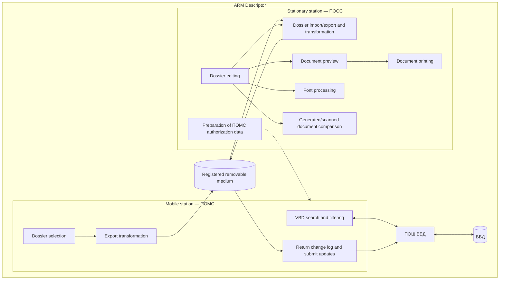

# ARM Descriptor — Software Components and Workstation Equipment

## Scope and evidence status

This page consolidates the component and equipment inventory from the supplied technical description. It is specification-level evidence. It does not prove that each listed peripheral was installed at every workstation or that each functional block maps to a separate executable.

## Main subsystems

The ARM Descriptor complex consists of:
- stationary station with dedicated software;
- mobile station with dedicated software.

The broader functional grouping identifies:
- data pre-processing and event generation;
- data collection;
- interaction with external information systems.

These are functional areas, not necessarily separate processes or deployable services.

## ПОСС — stationary-station software

The source lists these functional components:

1. Interaction with stationary-station information resources.
2. Dossier editing.
3. Document preview.
4. Document printing.
5. Font processing.
6. Comparison of generated and scanned documents.
7. Dossier import/export to and from the mobile station.
8. Data transformation for dossier import/export.
9. Preparation of authorization data for ПОМС.

The source also describes editing, preview, printing, MRZ layout, repeat printing, font preparation, document comparison and local dossier processing. Exact class/module ownership requires source-code verification.

## ПОМС — mobile-station software

The source describes:
- connection to ПОШ ВБД;
- structured search of VBD data;
- selection of dossiers or dossier groups;
- export and transformation into the stationary-station file representation;
- import/export through registered removable media;
- return of the original dossier and change log for submission to the VBD.

## ПОШ ВБД — gateway

The gateway mediates mobile-station access to the VBD. The wider specification describes request translation, access to reference data and consistency checking. Exact internal module boundaries and wire-level contracts are not specified here.

## Workstation hardware and peripherals

The supplied equipment list includes:

- stationary document-processing workstation;
- printer for document forms;
- scanner;
- uninterruptible power supply;
- laminator;
- monochrome laser printer with duplex-printing module;
- inkjet printer;
- machine-readable-zone recognition module;
- contactless card/document module;
- contact-card module;
- mobile station with dedicated software;
- mobile floor-standing air conditioner.

The source does not identify exact models, interfaces, driver versions, port assignments or which station owns every peripheral.

## Architecture diagram

The diagram is a logical reconstruction. It does not specify implementation protocols or physical connections beyond the documented removable-media exchange.

## Verification checklist

- Confirm component names and boundaries against the original diagram and project source.
- Map each peripheral to the workstation where it is installed.
- Identify device models, drivers and interface standards from approved inventories.
- Verify which components are implemented in ПОСС, ПОМС and ПОШ ВБД.
- Compare the specified component list with actual project references and installation packages.
