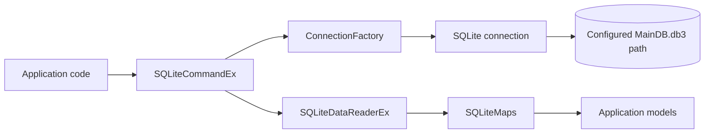

# C# / SQLite Data Access Layer Review

## Scope and evidence boundary

This review is limited to the five C# source files published under `materials/deshifrator/sources/DbStationary.Data/` in repository revision [`9106e0c`](https://github.com/ekatmoz88-alt/territory-descriptor-unified/tree/9106e0ceccaea4f2175d7d7e74893c6178069372).

The published source set contains the connection factory, command wrapper, parameter helpers, reader extensions and mapping functions. It does **not** contain provider classes such as `CaseProvider.cs`, the complete application source tree, project files, the SQLite database or automated tests. Provider-level statements from earlier drafts are therefore excluded from the findings below until the relevant source is added to the evidence set.

This is a static, source-based review. It does not claim that the application was built, executed, load-tested or verified against a live database.

The [DbStationary source register](../evidence/dbstationary-source-register.md) records the exact source snapshot, file identities, supported claims and evidence gaps.

## Component responsibilities

| Component | Responsibility directly visible in the published source |
| --- | --- |
| [`ConnectionFactory`](../sources/DbStationary.Data/ConnectionFactory.cs) | Builds a connection string, opens a SQLite connection and returns the connection held by the factory instance. |
| [`SQLiteCommandEx<T>`](../sources/DbStationary.Data/SQLiteCommandEx.cs) | Creates SQLite commands, assigns a connection, executes queries and maps returned rows. |
| [`SQLiteCommandEx_Params`](../sources/DbStationary.Data/SQLiteCommandEx_Params.cs) | Adds typed and named SQLite parameters, including GUID helpers. |
| [`SQLiteDataReaderEx`](../sources/DbStationary.Data/SQLiteDataReaderEx.cs) | Exposes typed column access and caches column ordinals. |
| [`SQLiteMaps`](../sources/DbStationary.Data/SQLiteMaps.cs) | Maps selected reader columns to application model objects. |
| Application providers | **Outside the published source scope.** Their call sites and transaction behavior are not assessed here. |

> **Model boundary:** Application models are consumers of mapped data. Their class definitions are not included in the published source set.

## Findings

| Area | Source evidence | Assessment |
| --- | --- | --- |
| Connection instance and synchronization | [`ConnectionFactory.cs`](../sources/DbStationary.Data/ConnectionFactory.cs#L11-L33) declares a static factory instance and returns the connection held by that instance. No synchronization is visible in this class. | **Source-based.** Concurrent access and runtime thread-safety are not established by this file alone. |
| Connection lifecycle | [`ConnectionFactory.cs`](../sources/DbStationary.Data/ConnectionFactory.cs#L18-L33) opens the connection in the private constructor and returns it from `GetConnection()`. This class exposes no close/dispose method. | **Source-based, incomplete.** Ownership and cleanup outside this class are unknown. |
| Command disposal | [`SQLiteCommandEx.cs`](../sources/DbStationary.Data/SQLiteCommandEx.cs#L92-L181) uses `using (_command)` in the parameterless execution methods. The parameter-array overloads [`AsSingle`](../sources/DbStationary.Data/SQLiteCommandEx.cs#L197-L216), [`AsScalar`](../sources/DbStationary.Data/SQLiteCommandEx.cs#L248-L254) and [`AsNonQuery`](../sources/DbStationary.Data/SQLiteCommandEx.cs#L275-L280) do not dispose the command in the method body. | **Source-based.** Command lifetime differs by overload. The `AsSingle(ResultMapDelegate)` overload delegates to the disposing parameterless overload, despite the adjacent XML comment describing a reusable command. |
| DataReader lifecycle | [`AsDataReader()`](../sources/DbStationary.Data/SQLiteCommandEx.cs#L220-L228) returns the reader from inside a `using` block. The reader is disposed when the method exits. | **Defect confirmed by source structure.** Runtime behavior has not been separately tested. |
| Parameter count and reassignment | [`ResetParams`](../sources/DbStationary.Data/SQLiteCommandEx.cs#L286-L293) checks the count with `Debug.Assert` and then assigns values by index. | **Source-based.** A shorter list can leave existing parameter values unchanged; a longer list can reach an invalid parameter index. Release-build behavior and caller impact require tests. |
| Typed reads and NULL handling | [`SQLiteDataReaderEx.cs`](../sources/DbStationary.Data/SQLiteDataReaderEx.cs#L28-L64) uses a direct generic cast and typed getters. `GetStringNullable()` returns `string.Empty` when the database value is NULL. | **Source-based.** This is a mapping convention, not proof that empty and NULL values are interchangeable in the application domain. |
| GUID mapping | [`SQLiteMaps.CaseModelMap`](../sources/DbStationary.Data/SQLiteMaps.cs#L24-L41) reads `CaseGUID` as a string and passes it to `Guid.Parse`. [GUID parameter helpers](../sources/DbStationary.Data/SQLiteCommandEx_Params.cs#L140-L155) are also present. | **Source-based.** The complete write/read path, stored representation and round-trip behavior are not established. |
| Sensitive field names | [`SQLiteMaps.UserModelMap`](../sources/DbStationary.Data/SQLiteMaps.cs#L15-L22) maps fields named `Login`, `Password` and `RoleCode`. | **Security review required.** This proves only that these fields are mapped; it does not establish that real credentials or personal data are present in the repository or database. |
| Exception handling | The published [`SQLiteCommandEx<T>`](../sources/DbStationary.Data/SQLiteCommandEx.cs) methods do not show provider-level catch/logging logic around command execution. | **Limited observation.** Provider and caller behavior cannot be assessed because those source files are not published. |

## Data flow represented by the available files

The diagram shows relationships visible in the selected source files. It is not a complete runtime call graph. The configured database file itself is not included in the repository.

## Follow-up verification

1. Obtain and review the relevant provider source, including `CaseProvider.cs`, before making claims about transactions, query call sites or provider-level exception handling.
2. Trace connection ownership and disposal across the complete application.
3. Test concurrent access and define the actual thread-safety requirements.
4. Test command and reader disposal on success, failure and early-exit paths.
5. Test parameter-count mismatches, repeated execution, NULL values and parameter reuse.
6. Add type-conversion and GUID round-trip tests against a controlled schema.
7. Review the handling and storage of the `Login` and `Password` fields without publishing real credentials or personal data.

## Limitations

The findings apply only to the five published C# files and the exact source revision recorded in the [source register](../evidence/dbstationary-source-register.md). They do not establish the behavior of unavailable providers, the full application, the actual database schema or a deployed environment.

This is a C# / SQLite review within the Dossier Processing Workstation documentation track. It is not part of the separate Oracle GLOBAL11 project.
