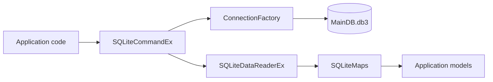

# Архитектурный обзор слоя доступа к данным

## Компоненты

- `ConnectionFactory` — singleton-подобная фабрика, создающая один `SQLiteConnection`, открывающая его в конструкторе и возвращающая через `GetConnection()`.
- `SQLiteCommandEx<T>` — fluent-обёртка над `DbCommand`; поддерживает маппинг результатов, scalar/non-query/list/enumerable.
- `SQLiteCommandEx_Params` — расширение для создания типизированных параметров.
- `SQLiteDataReaderEx` — вспомогательное чтение столбцов по имени с кешированием ordinal.
- `SQLiteMaps` — mapping-функции из строк результата SQL в модели приложения.

## Поток данных (наблюдаемый по предоставленным файлам)

## Риски и вопросы для проверки

1. **Singleton и потокобезопасность.** `_instance` и общее `_connection` не синхронизированы. Один открытый connection может использоваться конкурентно из разных потоков.
2. **Время жизни соединения.** `ConnectionFactory` открывает соединение один раз и не предоставляет явного механизма закрытия/освобождения.
3. **Освобождение команды.** `AsList`, `AsEnumerable`, `AsSingle`, `AsScalar` и `AsNonQuery` в отдельных перегрузках используют `using (_command)`, то есть уничтожают команду. Другие перегрузки повторно используют команду. Это поведение легко перепутать.
4. **`AsDataReader`.** Метод возвращает reader из блока `using`; при выходе из блока reader уже будет закрыт/освобождён. Это функциональный дефект.
5. **Параметры.** `ResetParams` проверяет число параметров только через `Debug.Assert`; в Release эта проверка может отсутствовать. Параметры задаются позиционно, что хрупко.
6. **Преобразование типов.** `GetValue<T>` делает прямое приведение; `GetStringNullable` возвращает пустую строку вместо `null`. Это может скрывать разницу между NULL и пустым значением.
7. **GUID.** `SQLiteMaps.CaseModelMap` читает `CaseGUID` как строку и вызывает `Guid.Parse`; неверный/пустой формат приведёт к исключению.
8. **Имена и типы.** В `SQLiteMaps` часть дат читается как `DateTime`, а часть как `string`. Реальный формат SQLite и SQL-запросы не приложены — проверить корректность нельзя.

## Что нужно для верификации

- файл `MainDB.db3` или `sqlite_schema`;
- SQL-запросы, передаваемые в `SQLiteCommandEx`;
- определения моделей из `Common.Data.Models`, `Common.Data.Models.Umms`, `DbStationary.Models`;
- целевая версия .NET и NuGet-зависимости.
